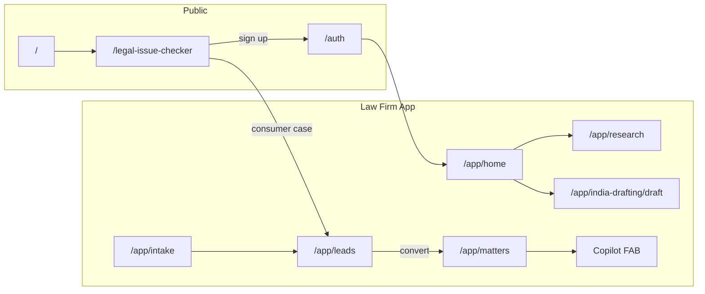

# Umbrella — YC Intro Video Flow

**Product:** Umbrella by Okay Legal  
**Purpose:** Full product demo for Y Combinator application intro video  
**Target length:** 60–90 seconds (YC sweet spot: ~60s)  
**Format:** Founder voiceover + screen recording (16:9 landscape)  
**Production URL:** https://umbrella.okaylegal.ai  
**Version:** 1.0 · July 2026

---

## What YC Wants From This Video

YC intro videos are not ads. They want to see:

1. **Who you are** — founders on camera for 5–10 seconds (optional but strong)
2. **What you built** — real product, not slides or mockups
3. **Why it matters** — one clear problem → one clear solution
4. **Traction signal** — even if early, show it works end-to-end

Keep it under **1 minute** if possible. One narrative thread beats a feature tour.

---

## The One-Line Story

> **A consumer describes a legal problem → AI analyzes it → a lawyer receives the lead → converts it to a matter → researches the law and drafts the filing — all in one platform.**

This is Umbrella's two-sided marketplace in one sentence. Every scene in this doc serves that arc.

---

## Product Architecture (for your mental model)



---

## Recommended Demo Arc (60 seconds)

| # | Scene | Route | Duration | What to show |
|---|-------|-------|----------|--------------|
| 1 | **Hook — the problem** | `/` | 8s | Landing hero. Type a real legal issue in the issue board. |
| 2 | **AI magic — consumer side** | `/` or `/legal-issue-checker` | 12s | Analysis progress → teaser preview with risk score + refinement panel |
| 3 | **Sign in** | `/auth` | 5s | Google sign-in → lands in lawyer app |
| 4 | **Platform home** | `/app/home` | 6s | Quick action cards — this is a full practice platform, not just AI chat |
| 5 | **Legal research** | `/app/research` | 12s | Natural language query → citations + verification card |
| 6 | **Document drafting** | `/app/india-drafting/draft` | 12s | Procedural determination → AI generates a court filing |
| 7 | **Lead → Matter** | `/app/leads` → `/app/matters/[id]` | 10s | Consumer lead from step 2 → convert to matter → matter hub |
| 8 | **Close** | `/app/matters/[id]` + Copilot | 5s | Matter-aware Copilot: "Draft engagement letter" |

**Total: ~70s** — trim scene 4 or 5 to hit 60s.

---

## Extended Arc (90 seconds)

Use this if you have room or are making a longer founder demo for investors.

| # | Scene | Route | Duration | What to show |
|---|-------|-------|----------|--------------|
| 1–8 | Same as 60s arc | — | 70s | — |
| 9 | **Document review** | `/app/document-review?mode=tabular` | 8s | Side-by-side clause comparison |
| 10 | **Billing close** | `/app/billing` or `/app/dashboard` | 7s | Invoice + trust balance — "practice management, not just AI" |
| 11 | **Founder tag** | On camera | 5s | "We're building the operating system for law firms." |

---

## Scene-by-Scene Playbook

### Scene 1 — Hook (8s)

**Route:** https://umbrella.okaylegal.ai/

**Action:**
1. Open landing page (clean browser, no extensions visible)
2. Scroll to hero issue board (`LandingIssueBoard`)
3. Type a concrete, relatable issue — use one of the sample prompts below
4. Hit submit

**Sample issue (India — bail):**
> My brother was arrested last night under BNSS. Police refused anticipatory bail. What are our options in Delhi?

**Sample issue (India — employment):**
> My employer terminated me without notice after 3 years. They owe 2 months salary. What legal notice can I send?

**Voiceover:**
> "Every day, millions of people face legal problems and don't know where to start."

**On-screen text:** *Describe your legal issue in plain English*

---

### Scene 2 — Issue Checker / AI Analysis (12s)

**Route:** https://umbrella.okaylegal.ai/legal-issue-checker  
(or stay on `/` if intake started from landing)

**Action:**
1. Show `IntakeAnalysisProgress` — animated multi-stage AI analysis (let it run; this is a money shot)
2. Land on `TeaserPreview`:
   - Risk bullets
   - Win-probability bar
   - Open `RefinementSidePanel` — AI asks a follow-up question (chip tap)
3. Brief flash of `InlineGoogleSignUp` CTA (don't complete sign-up here if doing lawyer arc next)

**Voiceover:**
> "Umbrella's AI analyzes the issue — applicable laws, risks, and next steps — in seconds. No legal jargon required."

**On-screen text:** *AI legal analysis · Risk score · Smart follow-up questions*

**Key components:** `legal-issue-checker-wizard.tsx`, `teaser-preview.tsx`, `refinement-side-panel.tsx`

---

### Scene 3 — Sign In (5s)

**Route:** https://umbrella.okaylegal.ai/auth

**Action:**
1. Sign in with demo lawyer account (pre-logged-in session is fine for recording — cut straight to app if needed)
2. Show redirect landing on `/app/home`

**Demo credentials (local/staging):**
- Email: `john.doe@lawfirm.com`
- Password: `password`

**Voiceover:**
> "On the other side, law firms get a complete practice platform — not another ChatGPT tab."

**Tip:** Record this scene last with a fresh browser profile, or use a pre-authenticated session and cut the auth UI to 2 seconds.

---

### Scene 4 — Platform Home (6s)

**Route:** https://umbrella.okaylegal.ai/app/home

**Action:**
1. Show quick action cards (tilt cards) — intake, research, drafting, leads, calendar
2. Brief sidebar glimpse: AI strip at top (Research, Document Drafting, Document Review, Section Finder)
3. Optional: `Cmd+K` command palette flash (power-user moment)

**Voiceover:**
> "Research, drafting, intake, CRM, billing — one workspace for the entire practice."

**On-screen text:** *AI + Practice Management · One platform*

---

### Scene 5 — Legal Research (12s)

**Route:** https://umbrella.okaylegal.ai/app/research

**Action:**
1. Enter a research query (pre-fill if you used landing handoff — otherwise type fresh)
2. Show jurisdiction/state picker (India: pick a state)
3. Submit → `LegalResearchProgress` phases
4. Results: structured answer with citations
5. Highlight `ResearchVerificationCard` and `SimilarCasesPanel`

**Sample query:**
> What is the procedure for regular bail under BNSS Section 480 in Delhi? What factors do courts consider?

**Voiceover:**
> "Lawyers ask questions in plain English. Umbrella returns cited answers — statutes, case law, verified sources."

**On-screen text:** *AI Legal Search · Citations · Verification*

**Key components:** `legal-research-progress.tsx`, `research-verification-card.tsx`, `similar-cases-panel.tsx`

---

### Scene 6 — Document Drafting (12s)

**Route:** https://umbrella.okaylegal.ai/app/india-drafting/draft?kind=india_regular_bail_bnss_480

**Action:**
1. Show `ProceduralDeterminationCard` — AI picks the right procedure
2. Fill `DraftMissingFieldsForm` (side sheet) — 2–3 fields only, skip the rest in edit
3. Generate → `IndiaDraftOutputPanel` with draft text + citations
4. Optional: `FilingSetStepper` if drafting a bundle

**Alternative entry:** `/app/legal-forms` → "Find & Draft" intent panel → pick a form

**Voiceover:**
> "From intent to court-ready filing. AI determines procedure, fills gaps, and drafts — with citations."

**On-screen text:** *10,800+ forms · AI drafting · Court-ready output*

**Key components:** `IndiaDraftOutputPanel.tsx`, `draft-history-sidebar.tsx`, `legal-forms-workspace.tsx`

---

### Scene 7 — Lead → Matter (10s)

**Route:** https://umbrella.okaylegal.ai/app/leads → `/app/leads/[leadId]`

**Action:**
1. Show leads kanban: NEW → SCREENING → CONSULT → ENGAGED
2. Open a lead (ideally one tied to the issue from Scene 2 — seed this in staging beforehand)
3. Show `LeadAnalysisPanel` / `LegalAnalysisView`
4. Click **Convert to Matter** → `ConvertToMatterDialog` → confirm
5. Land on `/app/matters/[matterId]` — matter hub with timeline

**Voiceover:**
> "Consumer cases flow directly into the firm's lead pipeline. One click converts a lead into a managed matter."

**On-screen text:** *Consumer → Lead → Matter · Seamless handoff*

**Key components:** `convert-to-matter-dialog.tsx`, matter hub page

**Pre-seed requirement:** Create a test consumer case in staging before recording so a lead exists in the pipeline. Do not rely on live generation during the take.

---

### Scene 8 — Matter Hub + Copilot Close (5s)

**Route:** https://umbrella.okaylegal.ai/app/matters/[matterId]

**Action:**
1. Matter timeline, notes, team
2. Open `MatterInlineCopilot` or `CopilotFloatingButton` (FAB, bottom-right)
3. Type: "Draft engagement letter for this client"
4. Show Copilot response starting (cut before full generation if slow)

**Voiceover:**
> "Every matter has an AI copilot that knows the case. Research, draft, strategize — in context."

**On-screen text:** *Matter-aware AI Copilot*

**Closing line (founder on camera or voiceover):**
> "Umbrella — the operating system for law firms. Consumer demand meets lawyer productivity."

---

## Pre-Production Checklist

### Environment setup

- [ ] Use **staging or production** with stable AI responses (not local dev unless deployed)
- [ ] Browser: Chrome, 1920×1080, 100% zoom, dark or light mode — pick one and stay consistent
- [ ] Hide bookmarks bar, disable extensions, use incognito or dedicated demo profile
- [ ] Screen recorder: OBS, Loom, or Screen Studio (cursor smoothing on)
- [ ] Microphone: external mic or AirPods — test levels before full take

### Seed demo data (do this 24h before recording)

- [ ] Lawyer account signed in and firm onboarding complete
- [ ] At least **1 lead** in `/app/leads` linked to a consumer issue-checker case
- [ ] At least **1 matter** with timeline entries, or plan to convert lead live on camera
- [ ] **1 completed research job** in history (fallback if live AI is slow)
- [ ] **1 saved draft** in `/app/saved-drafts` (fallback for drafting scene)
- [ ] AI credits sufficient — check plan usage at `/app/settings/plan-usage`

### Script the inputs (don't improvise on camera)

| Feature | Pre-written input |
|---------|-------------------|
| Issue checker | Bail scenario or employment termination (see Scene 1) |
| Legal research | BNSS Section 480 bail procedure query (see Scene 5) |
| Drafting | `india_regular_bail_bnss_480` or legal notice |
| Copilot | "Draft engagement letter for this client" |
| Refinement panel | Tap first suggested chip — don't read the question aloud |

### Test run (full dry run)

- [ ] Run the entire arc once without recording
- [ ] Note which AI steps take >10s — pre-generate those and cut to results
- [ ] Confirm lead → matter conversion works with your test account
- [ ] Export one screen recording clip to verify resolution and audio sync

---

## Production Tips

### Recording order (not narrative order)

Record scenes **out of order** for reliability:

1. **Matter hub + Copilot** (slowest, most likely to need retakes)
2. **Legal research** (wait for full result, then re-enter query for clean take)
3. **Document drafting** (pre-generate draft, re-enact the flow)
4. **Leads pipeline** (static UI, easy)
5. **Platform home** (static UI, easy)
6. **Issue checker** (live AI — record 3 takes)
7. **Landing hook** (record multiple issue types)
8. **Sign in** (2-second cut)

Assemble in narrative order in post.

### Speed tricks for AI-heavy scenes

| Problem | Fix |
|---------|-----|
| Analysis takes 15–30s | Record the progress animation separately; cut to pre-generated result |
| Research job slow | Open `/app/research/[jobId]` of a completed job; fake the entry with a typed query cut |
| Draft generation slow | Pre-generate; re-enact missing-fields form + cut to output panel |
| Lead doesn't exist | Seed in staging; never depend on consumer sign-up during the take |

### Visual moments that pop on camera

1. **Win probability bar** in teaser preview
2. **Refinement side panel** sliding in with chip questions
3. **IntakeAnalysisProgress** / **LegalResearchProgress** phase animations
4. **ProceduralDeterminationCard** with confidence indicator
5. **Leads kanban** with a card moving NEW → SCREENING
6. **Copilot FAB** pulsing bottom-right on every app page
7. **Cmd+K** command palette (optional 1s flash)
8. **Citation verification card** with green checkmarks

### Audio

- Record voiceover **after** screen capture (easier to sync)
- Or record both simultaneously if founder is comfortable narrating live
- Background music: none or very low — YC prefers clarity over production polish

---

## Voiceover Script (Full 60s)

Read at ~150 words/minute. Total: ~140 words.

```
Every day, millions of people face legal problems and don't know where to start.

[Scene 1–2]
Umbrella's AI analyzes the issue — applicable laws, risks, and next steps — in seconds.

[Scene 3–4]
On the other side, law firms get a complete practice platform — research, drafting,
intake, CRM, and billing in one workspace.

[Scene 5]
Lawyers ask questions in plain English. Umbrella returns cited answers from statutes
and case law.

[Scene 6]
From intent to court-ready filing — AI determines procedure and drafts with citations.

[Scene 7–8]
Consumer cases flow into the firm's lead pipeline. One click creates a matter with
an AI copilot that knows the case.

[Close]
Umbrella — the operating system for law firms.
```

---

## Founder On-Camera Intro (Optional, 5–10s)

Place at the **very beginning** or **very end**.

**Opening version:**
> "Hi, I'm [Name]. We're building Umbrella — AI-powered legal infrastructure for consumers and law firms. Here's how it works."

**Closing version:**
> "We're [Name] and [Name]. Legal is a $900B market still running on Word docs and email. We're fixing that. Apply with us."

---

## Alternate Arcs

### Arc B — Lawyer productivity only (45s)

Skip consumer issue checker. Start at `/for-lawyers` → `/auth` → `/app/home` → research → drafting → matter Copilot.

**Use when:** You want to emphasize B2B and de-emphasize marketplace.

### Arc C — No-login cold open (30s + product)

Start at https://umbrella.okaylegal.ai/demo (guided tour cards) → cut to live issue checker → CTA.

**Use when:** You need a hook before showing login-gated features.

### Arc D — India-specific (for India-focused YC narrative)

Add `/app/section-finder` (IPC→BNS crosswalk) between research and drafting.

**Sample flow:** Issue checker → Section Finder lookup → BNSS bail draft → lead → matter.

---

## Post-Production Checklist

- [ ] Total runtime ≤ 90s (aim for 60s)
- [ ] First 3 seconds: problem or bold claim — no logo splash
- [ ] Cursor movement smooth (use Screen Studio or post zoom/crop)
- [ ] Text overlays: 3–5 max, large font, 2s each
- [ ] Audio: voiceover clear, no echo, normalized to -16 LUFS
- [ ] Export: 1920×1080 MP4, H.264, < 100MB
- [ ] Watch on phone — most YC partners review on mobile
- [ ] Legal disclaimer (small, 2s end card): *"Legal information & practice tools — not a substitute for licensed counsel"*

---

## URL Quick Reference

| Feature | URL |
|---------|-----|
| Landing | https://umbrella.okaylegal.ai |
| Issue Checker | https://umbrella.okaylegal.ai/legal-issue-checker |
| Auth / Sign in | https://umbrella.okaylegal.ai/auth |
| Lawyer Home | https://umbrella.okaylegal.ai/app/home |
| Firm Intake | https://umbrella.okaylegal.ai/app/intake |
| Legal Research | https://umbrella.okaylegal.ai/app/research |
| Section Finder (India) | https://umbrella.okaylegal.ai/app/section-finder |
| India Drafting | https://umbrella.okaylegal.ai/app/india-drafting/draft |
| Legal Forms Hub | https://umbrella.okaylegal.ai/app/legal-forms |
| Document Review | https://umbrella.okaylegal.ai/app/document-review |
| Leads Pipeline | https://umbrella.okaylegal.ai/app/leads |
| Matters | https://umbrella.okaylegal.ai/app/matters |
| AI Command Center | https://umbrella.okaylegal.ai/app/ai-command-center |
| Dashboard | https://umbrella.okaylegal.ai/app/dashboard |
| Billing | https://umbrella.okaylegal.ai/app/billing |
| Guided Demo (no login) | https://umbrella.okaylegal.ai/demo |
| For Lawyers landing | https://umbrella.okaylegal.ai/for-lawyers |

---

## Key Source Files (for engineering prep)

| Area | Path |
|------|------|
| Issue checker wizard | `legal_web/components/issue-checker/legal-issue-checker-wizard.tsx` |
| Teaser / refinement | `legal_web/components/issue-checker/teaser-preview.tsx` |
| Landing issue board | `legal_web/components/marketing/landing-issue-board.tsx` |
| Auth flow | `legal_web/components/auth/unified-auth-form.tsx` |
| App home | `legal_web/app/app/home/page.tsx` |
| Legal research | `legal_web/app/app/research/page.tsx` |
| India drafting | `legal_web/app/app/india-drafting/draft/page.tsx` |
| Leads + convert | `legal_web/components/leads/convert-to-matter-dialog.tsx` |
| Matter hub | `legal_web/app/app/matters/[matterId]/page.tsx` |
| App shell / Copilot | `legal_web/app/app/app-shell-layout.tsx` |
| Sidebar nav | `legal_web/components/app-sidebar.tsx` |
| Demo tour data | `legal_web/lib/demo/sample-data.ts` |
| Guided tours | `legal_web/lib/tutorials/tour-registry.ts` |

---

## What NOT to Show

- Admin routes (`/admin/*`)
- Settings, billing setup, or onboarding wizard (unless 90s arc)
- Error states, loading failures, or credit-limit messages
- Half-finished UI or empty states (seed data first)
- Consumer dashboard (unless telling consumer-only story)

---

## Next Steps

1. **Seed staging data** — lead, matter, one research job, one draft
2. **Dry run** the 60s arc without recording
3. **Record out of order** — matter/Copilot and research first
4. **Record voiceover** from the script above
5. **Edit to 60s** — cut platform home to 3s if over time
6. **Founder intro/outro** — film on phone, overlay at start or end
7. **Review on mobile** before submitting

For a shot list spreadsheet or staging seed script, ask the engineering team to prep a `demo-seed` account with the lead ↔ matter ↔ issue-checker linkage ready to go.
