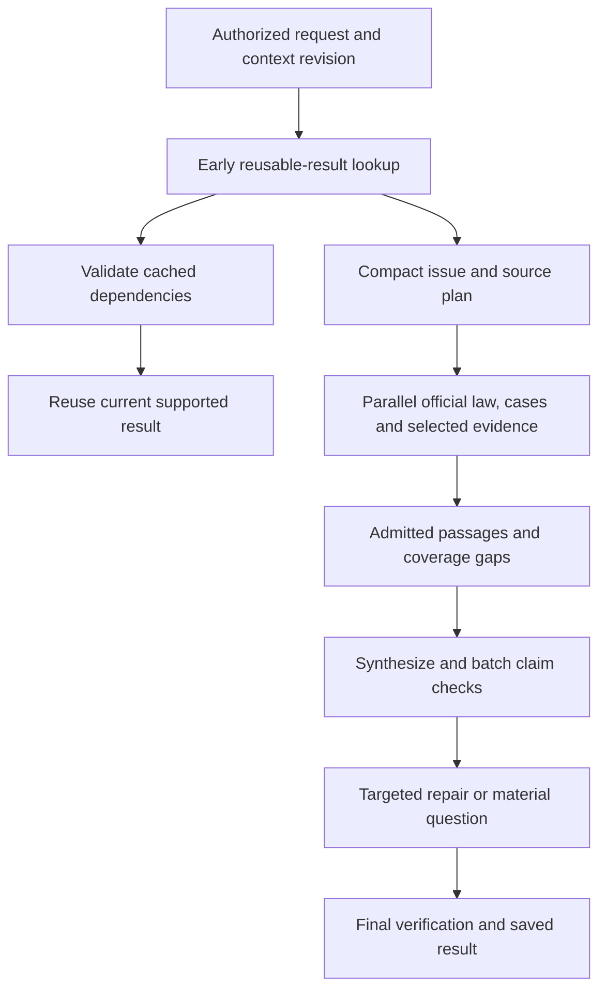

# Umbrella: post-implementation review, Gemini integration and fast, accurate AI workflows

**Repository:** `/Users/v/Desktop/Legal/legal-by-odaflow`  
**Review date:** 18 October 2026, following the first remediation implementation  
**Deliverable:** new Cursor-ready implementation specification; application code was not changed during this review.

## 1. Executive assessment

The implementation improves several of the original defects. It is not yet a complete implementation of the prior workflow plan. Source verification is less permissive, draft audit input is protected, scoped draft-job keys and an access resolver exist, Redis progress transport is present, and unsafe export fallbacks have been reduced. Keep these changes.

Three priorities remain:

1. **Finish correctness and workflow integration.** New service names do not establish end-to-end behavior. Release snapshots still accept some identity from the caller, V3 readiness has incompatible component names, StartWork does not actually enforce idempotency, and several new facades are not called by the relevant clients/services.
2. **Make document recommendations genuinely AI-assisted across legal work.** Current suggestions combine heuristics, curated catalogs and dependency lists; one drafting path adds AI-written reasons. Build one matter-aware recommendation service used from Research, Review, Draft, matter workspace, mobile and Word. Separate documents to draft, evidence to collect, and authorities to research.
3. **Add Gemini through the common provider architecture.** The main runtime explicitly permits only OpenAI and DeepSeek, maps an unknown Gemini model to OpenAI, rejects Gemini in the premium picker, and restricts tools to OpenAI. An old Google registry entry is not a working integration. Add Gemini for all supported AI task families, with explicit capability handling for tools, multimodal input, embeddings and audio.

Fast research should come from a shorter dependency path, useful caches, selective retrieval and verification reuse. It must not come from accepting snippets as law, dropping material facts or bypassing verification. No model/provider can promise perfect legal accuracy; evidence-backed answers and honest abstention remain the release standard.

## 2. Scope and validation actually completed

Read-only source review covered remediation changes, research/drafting call paths, provider transport, model registries/fallbacks, document suggestions/dependencies, client/matter context, progress/recovery, approval/export, and selected web/mobile/Word integration points. No AGENTS.md was found in the supplied Legal tree scan.

The working tree contains substantial existing changes; no resets, application edits, production migrations or live provider calls were performed. The deployed feature flags, API permissions/keys, database migration application, live model availability, UI rendering and production latency were not verified.

### Fresh test results

| Check | Result |
|---|---|
| Remediation + authority/research/context/saved-research tests, 5 suites | 36 passed, 5 failed, 41 tests |
| LLM/fallback/research routing/task dependency tests, 5 suites | 23 passed, 2 failed, 25 tests |
| **Total in this review** | **59 passed, 7 failed, 66 tests** |
| Five original defect regression cases | All 5 passed |
| Backend production TypeScript configuration | Passed no-emit typecheck |
| Full backend TypeScript configuration including test files | Failed with 5 diagnostics in 2 test files |

Do not combine these totals with the previous review's 85 tests; these are fresh runs with different selection.

Fresh test failures:

- `ai/unified-drafting/verification/draft-authority-verification.spec.ts`: 4 failures, covering identity/relevance/minimum authorities.
- `legal-search/legal-research-verification.service.spec.ts`: 1 failure, expected supported paraphrase remains unsupported.
- `ai/legal-research/legal-research-model-router.spec.ts`: 2 failures, route/model and cross-provider expectations differ from implementation. These may be stale tests or policy drift; do not relax legal checks simply to satisfy them.

Full-project typecheck diagnostics:

- `src/ai/drafting/accuracy/riya-medical-negligence.fixture.spec.ts:73`: constructor argument mismatch; DraftAccuracyRepairService supplied where ResearchMemoQualityValidatorService is required.
- `src/eval/india-research-benchmark.spec.ts:108–111`: impossible fixture-ID comparison, then `never` property errors and implicit-any destructuring.

Production typecheck success excludes specs and is not a full build/integration pass. An initial no-incremental invocation conflicted with composite project configuration; corrected commands redirected build metadata to scratch and produced the results above.

### Direct local reproductions on current code

Using existing service methods and local mocks, without live database/provider calls:

```json
{
  "geminiProvider": "openai",
  "geminiOnlyPicker": ["gpt-5.6-sol", "gpt-5.6-terra", "gpt-5.6-luna"],
  "allDimensionsPassedReadiness": {
    "overallScore": 25,
    "blockers": [],
    "readyForFiling": false
  },
  "knownActFakeSectionFindings": [],
  "repeatedStartWorkCreates": { "clients": 2, "matters": 2 }
}
```

Inputs respectively: Gemini model ID `gemini-3.8-flash`; Gemini-only picker configuration; passing findings across all current verification dimensions; known Act ID BNSS with fictitious section 99999; two identical StartWork requests with the same idempotency key. Reproductions establish function behavior, not deployed exploitability or real legal-model performance.

## 3. What changed since the first review

| Area | Current evidence | Assessment |
|---|---|---|
| Partial-source promotion | Registry no longer promotes by field presence; prompt entries reflect status | Fixed for original regression; receipts still optional |
| Client-supplied draft audit | Public UpdateCourtDraftDto now accepts text + optional expectedRevision only | Improved; server mutations and concurrency still need review |
| Text edit invalidation | Revision increments; audit/readiness cleared; human approval invalidated | Improved; check/update is not atomic optimistic concurrency |
| Client/matter access | ArtifactAccessResolver now checks ownership, grants and ethical walls | Useful shared service; adoption incomplete |
| V3 fact loading | Authorized matter check and tenant filters; first-20/10 limits removed | Original create-path defect improved |
| Draft-job idempotency | Scoped lookup/index + fingerprint added | Improved; fingerprint omissions and race path remain |
| Job SSE/progress | Access resolver and Redis pub/sub/refcount added | Improved; ordering/replay/echo/recovery incomplete |
| Empty findings filing readiness | No findings no longer yield perfect readiness | Original regression fixed; new component mismatch blocks legitimate readiness |
| V3 export | Real DOCX conversion; missing storage throws; PDF explicitly unavailable | Safer, but PDF workflow remains incomplete |
| Platform clarification | Answer appended as context and objective | Original discarded-answer defect improved; durable task/revision lifecycle still needed |
| Citation co-occurrence | Two authorities no longer produce verified support | Safer; weak platform synthesis is still separate |
| Shared research facade | ResearchApplicationService registered | No consumers found beyond registration/definition in scanned source |
| Shared client/file start | WorkContext service/controller added | No calls found in scanned web/mobile/Word clients; not idempotent |
| Word duplicate anchors | Multiple matches now rejected | Useful protection; real Word/revision/format testing still required |
| Handoff sender and expiry | Server sender and acceptance expiry check added | Improved; do not infer full sharing/transition coverage |
| Gemini | Old catalog entry only; runtime excludes Google | Not integrated |

This is a verified subset of the earlier backlog, not a declaration that every prior finding was re-tested or resolved.

## 4. Remaining gaps, with concrete changes

Paths are relative to the repository root. Re-read current source before editing.

### G01 — P0: filing snapshot is still not fully server-authoritative

**Files:** `legal_backend/src/ai/india-draft/india-draft.controller.ts`, approve ~179–203; `ai/drafting/platform/draft-filing-release.service.ts`; `human-review.service.ts`.

The controller resolves a snapshot and then overwrites caseRecordId, caseRecordVersion and playbookVersion with DTO values. Release service prefers a stored snapshot instead of resolving current fact/evidence/court/policy versions. Its snapshot includes evidenceRevision/courtProfileId, but HumanReview validity compares only case record/playbook/draft hash. Default pending values are not an acceptable filing identity.

**Work:** resolve canonical current versions from persisted case/evidence/court-profile records; reject incomplete identities; bind one digest covering content, facts, authorities, evidence, court policy and playbook. Approve and export atomically against expected versions. Distinguish reviewer permissions from document ownership so authorized reviewers can review assigned colleagues' work without opening all drafts.

**Acceptance:** change only evidence, facts, court profile or playbook → old approval cannot export; forged DTO versions cannot be stored as approved truth.

### G02 — P0: V3 readiness component vocabulary is incompatible

**File:** `platform/verification/verification.service.ts`, calculateFilingReadiness ~132–179 and mapFindingToComponent ~402.

Mandatory components include cause_title, parties, facts, legal_grounds, prayer and formatting. The mapper produces court_formatting, verification, citations and jurisdiction; its sectionTypeMap is unused. A structural pass maps to court_formatting, not any mandatory bucket. Current findings cannot establish all mandatory passes. The direct passing-dimensions fixture scores 25 with no blockers and ready=false. Component overwriting is also order dependent rather than aggregating all check outcomes safely.

**Work:** typed required-check manifest per document profile with explicit check IDs, section IDs, PASS/FAIL/NOT_RUN/INDETERMINATE and freshness. Use one vocabulary and aggregate failures monotonically. Explain every blocker. Do not restore permissive no-findings behavior.

**Acceptance:** valid evidence-backed fixture can become eligible; removing a mandatory check blocks; reordering findings changes nothing; a later pass cannot erase a separate failure.

### G03 — P1: statutory existence still does not verify a section

**File:** `ai/drafting/platform/validators/statute-existence-verifier.ts`.

The uppercase-ID escape was removed, so unknown Acts now warn. Known Act with section 99999 still yields no findings; regex draft-section checking remains a no-op. Primary-text/version resolution is not implemented by this validator.

**Work:** use the existing bare-Act/section services and source connectors behind common statutory evidence admission. Validate exact Act, provision, subdivision, temporal/territorial applicability, exceptions and savings. Unknown is not pass. Keep naming checks distinct from actual legal existence.

### G04 — P1: StartWork computes a key but does not use it for idempotency

**Files:** `work-context/work-context.service.ts`, controller.

scopeKey is returned, not persisted/checked. New client and matter creation happen on every retry in separate operations. The same local request/key produced two clients and two matters. New-client access can fail for users whose access derives only from already assigned matters; client creation may then leave an orphan. The interface DTO has no class-validator runtime schema. Default country is IN rather than explicitly confirmed or resolved from context.

**Work:** durable tenant/actor/operation request record, canonical fingerprint, atomic client/matter/access grants, resumable operation creation and typed validation. Reuse Clients/Matters policy methods while arranging transactions correctly. Preserve explicit standalone mode and country.

**Acceptance:** retry/concurrent retries create one linked client/file; changed payload same key conflicts; authorized associate can create their file; validation failure rolls back or provides a recoverable tracked operation.

### G05 — P1: shared workflow services are not wired end to end

**Files:** ResearchApplicationService, WorkContextController and scanned `legal_web/app`, `components`, `lib`; `legal_app/lib/features`, `core`; Word add-in.

The research facade has no consumer in the scanned references; platform ResearchWorkflowService still owns weaker synthesis. No client calls to work-context/start or StartWork were found in those application source trees. Adding services alone does not provide the requested client/file journey.

**Work:** one StartWork command and research/draft operation contract on all surfaces. Route compatibility controllers to canonical application services; test actual network requests. Keep existing authorized selected-matter context behavior.

### G06 — P1: draft-job request identity/recovery is only partial

**File:** `ai/unified-drafting/draft-job.service.ts` ~85–193; schema and new `20261018_umbrella_u01_u10` migration.

Fingerprint omits result-affecting fields such as attachments, parties, pinned sources, language, courtName, quality tier and bundle settings. Concurrent-duplicate catch returns the raced job without comparing its fingerprint. Queue failure stores pending_dispatch but no replay/reconciler consumer was found in source references. A retry finds the existing queued job and does not necessarily dispatch it.

**Work:** canonical fingerprint of all semantic inputs/policy versions, equality check in normal and race paths, persisted complete resumable input and transactional outbox/dispatch reconciler. Applied database migration is not verified here.

### G07 — P1: progress transport needs event identity and real recovery

**File:** `unified-drafting/progress/draft-progress.service.ts`.

An emit delivers locally and publishes; a same-process Redis subscriber can deliver the same event again. Terminal persistence method is a stub comment; polling fallback is referenced rather than implemented there. No sequence/replay/dedup identity is attached by that service. Only source review, not process-separated integration testing, supports these conclusions.

**Work:** eventId, monotonic sequence, producer/operation/revision identity; dedup self-echo; durable status/stage events and authenticated resume. Bound subscriptions and cleanup; reconnect must restore latest state.

### G08 — P1: evidence receipt is optional and snippet budget remains thin

**Files:** `unified-drafting/contracts/verified-source.ts`, registry and generation callers.

The contract adds evidenceReceiptId but does not require it for verified status. Prompt projection still truncates permitted passage to 400 characters, which can omit an exception/holding context. Citable may rely on a proposition without a verbatim passage if an upstream component marks it verified.

**Work:** enforce server evidence receipts at the admission boundary, preserving exact passages and applicability. Allocate passage budgets by issue/proposition, include necessary exception/context, and distinguish paraphrase support from exact quotation. Do not send every full judgment indiscriminately.

### G09 — P1: document suggestions are not a shared AI decision capability

**Files:** `ai/draft-intent/draft-intent.service.ts`, `matter-intelligence/action-recommendation.service.ts`, `matter-task-graph.service.ts`, `document-dependency.service.ts`.

Actions/task graphs mainly come from rules/default arrays and curated kinds. Matter classification calls AI only below a confidence threshold and only if OpenAI is configured. One bundle path enriches recommendations with AI reasons; that prompt is Indian-specific and sees the first 2,500 characters. Required evidence comes from static dependencies, and mention of an event/document in text can satisfy checks without a real uploaded artifact.

**Work:** shared AI recommendation plan over confirmed matter context plus allowed document catalog; deterministic legal/procedural validation after AI. Separate evidence mentioned, provided, extracted and reviewed. Recommendations must persist, update after new facts and show support/gaps rather than static high confidence.

### G10 — P1: Gemini is blocked and registries disagree

**Files:** `ai/model-costs.config.ts`, `premium-models.config.ts`, `llm-completion.service.ts`, `platform/model-registry/model-registry.data.ts`.

AiLlmProvider/allowed providers are only openai/deepseek. Unknown Gemini IDs resolve to openai. Premium picker deliberately removes Gemini/Google IDs then substitutes default OpenAI models. Platform registry still advertises an old Gemini 1.5 Flash active entry, but it is disconnected from live completion transport.

**Work:** canonical registry with explicit provider/model identity and capability metadata; unknown model IDs fail clearly. Add Google transport and task routing, picker/admin capabilities and health checks together. Do not merely remove the picker filter and assume integration works.

### G11 — P1: OpenAI-only gates and direct calls bypass a provider switch

**Files:** MatterIntelligenceService, evidence/graph extractors, DraftIntentService, AiPolicyService, health/command center; `ai/ai-gateway.service.ts` direct planning call ~8406; embeddings service.

Even after adding Gemini to complete(), OpenAI-specific readiness gates would disable AI in Google-only deployments. completeWithTools rejects non-OpenAI. A direct gateway HTTP call and embeddings transport still use OpenAI transport. Whisper/audio is a separate capability.

**Work:** capability-aware routing and readiness per task; migrate direct generative requests to gateway. Support tools, structured output and multimodal interfaces. Treat audio/embeddings as explicit provider adapters, not strings passed through chat completion.

### G12 — P1: model floors and “cross-provider” flags need task semantics

**Files:** llm-fallback.config.ts, serious-model-lock.ts, research/draft routers, unified model aliases.

Model roles remain mostly hard-coded OpenAI names. Fallback capability is inferred from pricing tiers; some serious paths use only mid floor. A flag saying requireCrossProviderVerification does not itself ensure a distinct actual provider after fallback. Serious-model-name regex is not a cross-provider legal-quality policy.

**Work:** task capabilities + benchmark qualification + data-policy constraints; record actual model/provider and fallback reason per stage. When independent verification is required, enforce distinct execution/provider policy or mark it unavailable. Two models agreeing does not establish legal truth.

### G13 — P1: research does too much work before a reusable-result cache check

**File:** `ai/ai-gateway.service.ts`, executeLawyerLegalResearch ~2440–5840.

Cache lookup around 4178 follows classification/planning, retrieval and supplementation, firm memory, section grounding, India/Kenya ingest/recovery and prompt construction. Existing retrieval orchestrator already uses Promise.all/Promise.allSettled; retain that good work. Optimization should shorten the whole workflow dependency path rather than blindly wrapping every await in Promise.all.

Multiple synthesis/retrieval-repair/verification/citation-audit passes may execute, depending on branches. Preserve final exact-output verification; reuse unchanged claim evidence and avoid repeated equivalent checks.

### G14 — P1: retries and failure semantics need one end-to-end budget

**Files:** llm-retry.util.ts (default up to 12 attempts), llm-completion fallback chain, research timeout/repair branches.

Provider retries, fallbacks, source recovery and repairs can compound latency. Fail-soft research still records a degraded fallback as completed, with review/insufficient labels. That label honesty is useful, but a note without evidence must not look like completed verified research.

**Work:** operation deadline/cancellation budget propagated to all child calls; short interactive retry limits, circuit breakers and provider-specific backoff; explicit partial/degraded/awaiting-user outcomes. Resume long work asynchronously. Stop when material evidence is sufficient, or abstain with exact gaps when budget expires.

### G15 — P1: existing verification and evaluation baseline is still red

Resolve the 7 current test failures and 5 test typecheck diagnostics. Distinguish stale expectations from real defects using reviewed source passages. A production-only typecheck pass is not grounds to ignore broken benchmark fixtures.

## 5. AI document recommendations: required product behavior

### Three recommendation types

| Type | Meaning | Examples of UI actions |
|---|---|---|
| Work product | What the user may need to draft | Research memo, notice, pleading, affidavit, agreement, response |
| Matter evidence | What is needed to support facts/work | Contract, payment proof, disputed order, service record, termination letter |
| Legal authority | What law/cases/rules need investigation | Exact provision/version, procedural rule, leading/contrary decisions |

Never present these as interchangeable. A “termination occurred” timeline event does not prove a termination letter was uploaded. An AI suggestion is not a verified mandatory filing requirement.

### Shared service and triggers

Create one DocumentRecommendationService (or extract existing DraftIntent capability into that ownership) and reuse it:

- When starting research: suggest useful work product and evidence, while allowing research to proceed if nonessential evidence is missing.
- After research: suggest next documents from supported conclusions, forum and procedural stage, linked to that result version.
- Before drafting: suggest primary document and related bundle; ask material procedural questions; expose missing evidence.
- During review: propose supporting documents or follow-up drafting based on findings, not unrelated catalog items.
- From matter workspace, Flutter and Word: same operation and recommendation IDs, same selections and state.
- After new facts, evidence or user corrections: refresh only affected recommendations and explain changes.

An internal AI extraction or formatting call need not trigger a new recommendation dialog. “Every workflow” means consistent user-facing capability, not more repeated inference/UI interruptions.

### AI + deterministic validation pipeline

1. Load authorized case snapshot: country/forum/stage, user objective, confirmed/contested facts, existing artifacts, prior research and user-selected scope.
2. Retrieve a small applicable document catalog/playbook set by jurisdiction, proceeding and date.
3. AI returns structured ranked proposals, evidence dependencies, reasoning grounded in fact IDs, uncertainty and questions. It must be allowed to return no suitable supported document.
4. Validate IDs against catalog; check jurisdiction/stage, mutually exclusive options, required procedural predicates and duplicate/already-completed work. Legal “mandatory” assertions require primary procedural support or review.
5. Offer a small ranked set with Why this, Inputs needed, Source/policy, and Prepare/Collect/Review actions. Do not overwrite an explicit user document choice silently; explain conflicts.
6. Persist accepted/rejected/deferred choices bound to case/research/policy versions; refresh when dependencies change.

Proposed contract:

```ts
type DocumentRecommendation = {
  id: string;
  category: 'work_product' | 'matter_evidence' | 'legal_authority';
  catalogId?: string;
  title: string;
  action: 'draft' | 'collect' | 'research' | 'review';
  reason: string;
  factIds: string[];
  authorityEvidenceIds: string[];
  jurisdiction: string;
  proceduralStage?: string;
  prerequisites: Array<{
    id: string;
    state: 'missing' | 'mentioned' | 'uploaded' | 'extracted' | 'reviewed';
    artifactVersionId?: string;
  }>;
  priority: 'next' | 'supporting' | 'later';
  status: 'proposed' | 'needs_clarification' | 'validated' | 'unsupported';
  questions: string[];
  contextRevision: number;
  policyVersion: string;
};
```

AI supplies hypotheses; server supplies trusted IDs/authorization and validation outcome. Use country-neutral prompts parameterized with forum and local terms. Keep legal research case-law coverage mandatory and explicit, without injecting irrelevant citations into document types that belong with a separate authority packet.

## 6. Gemini integration: architecture and concrete file plan

### Interpretation of “wherever AI is called”

Make Gemini available through common routing for every supported AI task family. Allow global default plus per-task/tenant override and qualified fallback. When a task needs a capability that the selected model/adapter does not support, fail clearly or select a policy-approved alternative; never route a Gemini ID to OpenAI or silently disable AI.

Do not duplicate all work across providers. Gemini does not replace source verification, deterministic checks or advocate approval. Preserve existing providers for controlled comparison, qualified fallback or explicit selection.

### Verified official implementation references

Checked during this review:

- Google TypeScript SDK: https://github.com/googleapis/js-genai — official `@google/genai`, server-side SDK for Gemini/Google Cloud use.
- Models: https://ai.google.dev/gemini-api/docs/models — current catalog includes `gemini-3.8-flash`; validate selected models in the actual deployment/project before pinning.
- OpenAI compatibility: https://ai.google.dev/gemini-api/docs/openai — supports compatible requests with separate Google credentials/base URL. It does not make existing OpenAI-specific provider detection correct.
- Structured output: https://ai.google.dev/gemini-api/docs/structured-output.md — schema support must be mapped/tested for the chosen model/API.
- Search grounding: https://ai.google.dev/gemini-api/docs/google-search — source annotations/search metadata are returned; normalize the exact chosen API version's shape.
- Context caching: https://ai.google.dev/gemini-api/docs/caching .
- Rate limits: https://ai.google.dev/gemini-api/docs/rate-limits .
- Embeddings: https://ai.google.dev/gemini-api/docs/embeddings .
- API keys: https://ai.google.dev/gemini-api/docs/api-key .

These references establish supported building blocks, not live availability, project quotas, pricing guarantees or legal-data policy compliance for this deployment. Pin a tested SDK version and verify Node compatibility. Do not use the old Gemini 1.5 registry entry as the integration target, and do not guess a flagship model ID.

### Preferred provider implementation

Add a native Gemini adapter behind LlmCompletionService or a small provider interface. Retain existing complete() compatibility while expanding common request/response types. Native SDK is the preferred path for tools, multimodal inputs, structured output and grounding metadata; a tested OpenAI-compatible adapter can support a limited text subset if explicitly documented. Do not maintain two conflicting Google backends without a clear capability split.

```ts
interface AiTaskRequest {
  task: string;
  operationId: string;
  contextRevision: number;
  providerPreference?: 'google' | 'openai' | 'deepseek' | 'auto';
  messages: unknown[]; // replace with typed text/file/tool parts
  responseSchema?: Record<string, unknown>;
  tools?: unknown[];
  groundingPolicy?: 'none' | 'public_legal_search';
  deadlineAt: string;
  signal?: AbortSignal;
  requiredCapabilities: string[];
  qualityPolicyId: string;
}
interface AiTaskResult {
  content: string;
  structured?: unknown;
  toolCalls: unknown[];
  citations: unknown[];
  actualProvider: string;
  actualModel: string;
  modelVersion?: string;
  finishReason: 'completed' | 'truncated' | 'blocked' | 'cancelled' | 'failed';
  usage: { input: number; output: number; cached?: number; reasoning?: number };
  searchUsage?: unknown;
  fallbackReason?: string;
}
```

Define real typed content/tool/citation structures in implementation. Normalize refusals, blocked/empty candidates, truncation and tool finish states; never coerce them into successful blank legal text. Validate JSON server-side even when schema output is enabled. Keep provider-specific reasoning controls inside the adapter.

### Files to modify

| File/area | Required change |
|---|---|
| `ai/model-costs.config.ts` | Add Google provider; explicit supported models/capabilities; unknown IDs rejected; qualified quality tiers |
| `ai/llm-completion.service.ts` | Delegate Google completion/tools/stream/structured inputs; common deadline, cancellation and normalized usage/errors |
| Proposed `ai/providers/gemini-provider.ts` | Native SDK client, separate auth/project config, model capability translation |
| `ai/llm-fallback.config.ts`, retry utility | Task-qualified cross-provider chain, shared time budget, avoid nested long retries |
| `ai/premium-models.config.ts` | Remove provider exclusion only after registry/transport support; preserve requested model or explain unavailability |
| `platform/model-registry/*` | Reconcile obsolete entries with canonical registry and real capabilities |
| Research router, serious-model-lock, draft routers/aliases | Logical task roles instead of embedded vendor names; verified/gated fallback |
| `ai/ai-gateway.service.ts` | Remove direct OpenAI planning HTTP path; route every generative stage via common service |
| Matter classification/evidence/graph/recommendations | Replace OpenAI-readiness gates with required-task capability checks |
| `ai/ai-policy.service.ts`, command center, health | Google capability/health visibility and tenant data-policy enforcement |
| Costs, usage recorder, token charges, billing reconciliation | Actual Google usage, cache/search/reasoning costs and fallback accounting; no made-up rates |
| `embeddings/embedding.service.ts` | Explicit optional Google embedding adapter + index migration strategy |
| OCR/meeting/audio services | Capability-specific multimodal/transcription routing where qualified, preserving page/timestamp provenance |
| `.env.example`, deployment/worker configuration | Document server-side Google settings; no keys in Next.js/Flutter/Word or repository |
| Web/mobile/Word models/settings | Shared capability list, supported model selections and clear actual-provider state |

Proposed config names (application design, not SDK-reserved fields):

```dotenv
AI_ALLOWED_PROVIDERS=google,openai,deepseek
AI_DEFAULT_PROVIDER=google
GEMINI_API_KEY=<server secret only>
GEMINI_FAST_MODEL=<project-validated model ID>
GEMINI_REASONING_MODEL=<project-validated model ID>
GEMINI_VERIFIER_MODEL=<project-validated model ID>
GEMINI_GROUNDING_ENABLED=true
GEMINI_REQUEST_TIMEOUT_MS=<budgeted value>
AI_PROVIDER_FALLBACK_ENABLED=true
```

Optional Google Cloud/Vertex transport requires separate project/location/auth configuration and supported model/capability tests; do not treat an API-key Developer API setup as identical to that deployment. Credentials are an operational setup item, not something needed to finish this review plan. No live connection was made in this review.

### Task coverage matrix

| AI task family | Gemini plan | Accuracy safeguard |
|---|---|---|
| Intake, intent, classification, clarifying questions | Fast structured model | Validate enums, facts, jurisdiction and uncertainty |
| Document/evidence/work-product recommendations | Structured recommendation role | Catalog/stage/source validation and artifact presence |
| Research planning/query rewriting | Fast role, one compact plan | Keep legal dates/terms and no privileged public-search leakage |
| Authority discovery | Grounded search or existing connectors | Discovery leads only; fetch and verify primary text |
| Legal synthesis and case comparison | Qualified reasoning role | Evidence-only propositions, contrary sources, explicit gaps |
| Claim/authority verification | Qualified independent verifier role | Exact source checks and fail-closed material claims |
| Draft outline/sections | Fast/mechanical or reasoning by task | Confirmed facts and supported sources; no invented blanks |
| Coherence/pleading review/repair | Targeted reasoning/verifier role | Revision-bound diff; bounded repairs |
| Contract/tabular review and extraction | Structured/multimodal role | Per-cell/page anchors; partial coverage visible |
| Assistant, copilot, tools and workflow steps | Common text/tool router | Tool authorization, bounded loop and real tool results |
| Meeting summaries, email, translations, style | Common role with context permissions | Preserve source IDs, reviewed translations for reliance |
| OCR/document understanding | Qualified multimodal path | Deterministic parsing first; OCR confidence is not legal truth |
| Embeddings | Separate embedding role/index version | No vector mixing or silent dimension changes |
| Audio transcription/live | Separate qualified audio adapter | Speaker/time provenance and explicit capability support |
| Alerts, monitors, strategy, deadlines, graph extraction | Common task router | Legal rules/deadlines remain evidence-backed and reviewed |

Do not route deterministic accounting arithmetic, access decisions, filing certification or statutory-date computations to AI just to claim all tasks use Gemini.

## 7. Search grounding and maximum legal accuracy

Gemini search grounding is an additional discovery channel, not a replacement for India Code, official court judgments, Kenya Law or evidence admission.

1. Build de-identified, issue-specific public queries. Keep client names/documents out unless truly necessary and permitted by the selected data policy.
2. Discover official Act/judgment/rule URLs through existing connectors and/or Gemini grounding. Preserve source/search annotations and provenance from the actual adapter API.
3. Fetch authoritative content; handle redirect/security limits, PDFs, dynamic shells and OCR coverage. A search summary cannot establish a quoted passage.
4. Verify identity, exact provision/passage, date/version/commencement, territorial/forum fit, binding weight and proposition support. Check later treatment separately; UNKNOWN stays explicit.
5. Search contrary authority for material issues and record case-law coverage on every research/drafting operation.
6. Generate from an admitted evidence pack. Preserve factual allegations versus confirmed facts and forbid new source IDs.
7. Verify the actual final output bytes/claims; target only changed/unsupported claims during repair. Record verifier/model/evidence versions.
8. Display supported answer, partial result or question with exact unresolved dependencies. No “verified” status from model agreement, Google citation presence, authority counts or populated fields alone.

Normalize grounding metadata without assuming one SDK/API version. The documentation inspected includes annotation-based output, while other supported endpoints may use different metadata; contract-test the actual selected endpoint. Surface required source/search attribution according to the applicable API terms. Treat provider search HTML as untrusted, rendering only through a deliberately reviewed attribution component.

## 8. Smart research: shorten the dependency path

### Target execution graph



### Performance changes grounded in current code

| Current bottleneck/risk | Change | Preserve |
|---|---|---|
| Result cache check follows extensive retrieval | Early request-index lookup by scope/context/task/policy; validate source dependencies before reuse | Tenant/matter authorization and current-law freshness |
| Repeated classification/planning | One structured task/issue plan reused across stages | Material ambiguity questions and explicit dates |
| Multiple connector supplements | Bounded parallel fan-out per independent issue/source; dedup canonical identities before fetch | Primary law and contrary-case coverage |
| Re-fetch same artifact | Cache fetched artifact/extraction by canonical URL/version/hash; conditional freshness probes where supported | Event/as-of temporal applicability |
| Whole-memo rechecks after small repair | Claim hash + passage hash + verifier/policy version result cache; invalidate dependencies | Final exact-output audit |
| Broad document context | Retrieve sections/paragraphs with fact/evidence coverage manifest | Material evidence beyond first N items |
| Deep reasoning for formatting | Fast role for mechanics; reasoning for substantive/conflicting law | No capability downgrade for high-stakes output |
| Long serial fallback retries | One operation budget, short interactive retries, circuit breakers and approved fallback | Correct error/review/degraded state |
| Multiple independent review calls | Batch compatible claim checks once; escalate uncertain material claims selectively | Deterministic exact-quote/identity checks |
| UI waits for all work | Durable async progress, supported partial sections and questions | No premature final/verified labels |

Current retrieval already parallelizes some work. Do not remove those mechanisms or parallelize dependent repairs/approval/persistence mutations. Bound per-host concurrency and provider quota usage; a large fan-out can increase tail latency or source blocking.

### Caching policy

- **Request index:** canonical query/intent + jurisdiction/forum + as-of/event date + selected artifact versions + matter/context revision + task/quality/source policies + actual model/prompt version where output depends on them.
- **Public source cache:** exact artifact/version, fetched time, freshness/effective period and integrity. Share public law only where policy/rights permit.
- **Private evidence cache:** tenant/matter/artifact permission scope; never reuse unauthorized client data or retrieved private context.
- **Verification cache:** proposition text hash + verbatim passage/artifact hash + identity/date/status + verifier/policy version. New law/evidence invalidates affected claims.
- **Provider context cache:** optional Google cache for reusable long evidence/context, with scope, TTL/deletion and policy checks; provider caching does not establish legal freshness.
- **In-flight deduplication:** concurrent same semantic request shares authorized computation or awaits one operation; do not share an output across users without access checks.

### Budgets and success measures

Record baseline P50/P95 by task, country, source availability, document volume and cache state. Measure queue wait, plan, retrieval, source fetch/extraction, synthesis, verification, repair and persistence separately. Report source coverage and reviewer corrections beside latency.

Initial optimization goal: a substantial measured reduction (for example 30% on matched standard-research fixtures) without increasing accepted unsupported claims or reducing material issue coverage. This is an engineering target, not measured current performance or a promised wall-clock SLA. Publish actual SLOs only after live canary measurement.

Use adaptive source/claim stopping: stop when each material issue has sufficient admissible support and contrary-source checks, not when an arbitrary citation quota is met. Budget exhaustion yields a partial/awaiting-user result with exact gaps; it must not automatically promote cheaper unsupported output.

## 9. Implementation tickets for Cursor

| ID | Priority | Work | Acceptance |
|---|---|---|---|
| N01 | P0 | Correct current release snapshot/approval source of truth (G01) | Fact/evidence/court changes invalidate exact-version approval |
| N02 | P0 | Replace V3 readiness scoring with typed check manifest (G02) | Legitimate fixture can pass; empty/missing/reordered findings behave safely |
| N03 | P1 | Persist StartWork idempotency/transaction/access + typed DTOs | Same key creates one client/file; explicit jurisdiction preserved |
| N04 | P1 | Complete job fingerprint, race check and dispatch recovery | Modified attachments/parties/language same key conflicts; outage recovers |
| N05 | P1 | Stable progress event identity/replay/dedup | Split API/worker, reconnect and multiple subscribers show correct sequence |
| N06 | P1 | Enforce statutory and evidence-receipt admission | Known-Act fake section never passes; status alone cannot establish evidence |
| N07 | P1 | Canonical provider/model/capability registry | Google/OpenAI/DeepSeek resolved correctly; unknown model fails explicitly |
| N08 | P1 | Native Gemini provider adapter + schema/tools/stream/errors/usage | Mock transport contracts and live canary capability checks pass |
| N09 | P1 | Task policies, fallback floors, health/cost/config integration | Google-only deployment runs supported tasks; actual provider/cost recorded |
| N10 | P1 | Remove direct generative transports and OpenAI-only readiness gates | Static guard + runtime task tests find no accidental provider bypass |
| N11 | P1 | Shared AI document recommendations + catalog/procedure validation | Research/review/draft return contextual proposals and missing-evidence states |
| N12 | P1 | Wire StartWork/recommendations/research facade across web/mobile/Word | Full client/file/research-to-draft journey uses common operation IDs |
| N13 | P1 | Early cache, source/claim caches and dependency invalidation | Reuse reduces work while changed source/facts invalidate appropriately |
| N14 | P1 | Bounded parallel retrieval + one end-to-end deadline | Independent work overlaps; no duplicated source fetch or long retry explosion |
| N15 | P1 | Batch/selective verification + bounded targeted repair | Final exact content verified; material changed claims cannot reuse stale pass |
| N16 | P1 | Resolve 7 failing tests and benchmark type errors | Test expectations match documented policies and authoritative passages |
| N17 | P2 | Qualified Google embeddings/audio/multimodal adapters where applicable | Explicit supported/unsupported status; vector/audio migrations tested |
| N18 | P1 | India/Kenya legal-quality + performance benchmark and controlled rollout | No critical false accepts; publish actual latency/cost/coverage and rollback evidence |

Suggested dependency order: N01–N06 and N16 first; N07–N10 shared provider groundwork; N11–N12 recommendation/product wiring; N13–N15 speed work measured against N18; N17 only with explicit capability and migration readiness. Implement small vertical slices rather than replacing the whole AI subsystem at once.

### Required regression and end-to-end cases

1. Google-only configuration: classification, recommendations, research, drafting, review, tools and translation work; any unavailable modality is explicitly identified, not routed to OpenAI silently.
2. Gemini ID lookup and picker preserve requested provider/model or give clear unavailable status; no vendor substitution by unknown-ID fallback.
3. Gemini response fixtures: structured output, invalid JSON, no candidates, blocked/refused, truncated, timeout, 429, 5xx, tool calls and streamed cancellation.
4. Grounded answer with missing/unfetchable official body stays discovery/partial; false or wrong-proposition case is rejected even if two models agree.
5. Indian and Kenyan document recommendations vary by correct jurisdiction/forum/stage; missing material facts trigger questions; mandatory-document assertions have evidence.
6. Mentioned termination/FIR/order is not treated as an uploaded, extracted or reviewed document. Unknown catalog IDs and incompatible bundles are rejected.
7. Same client/file start or draft request replay produces one operation; changed semantic inputs same key conflict even under concurrency.
8. New evidence/facts/court rule invalidates stale recommendations, verification caches and approvals, even if draft text is unchanged.
9. Cache hit is authorized and freshness checked; private content cannot appear in another matter/tenant or public search query.
10. Late-file material evidence and non-English/scanned input retain page/fact coverage; no silent first-N material truncation.
11. Provider failure never returns an empty successful legal answer; partial/degraded results remain clear and do not qualify for filing release.
12. Production API/worker credentials/config, database migrations, queue outage recovery, progressive UI and Word/mobile parity are exercised in deployment-like tests.

## 10. Reproducible test commands

Run from `legal_backend`:

```bash
node node_modules/jest/bin/jest.js --runInBand --no-coverage --runTestsByPath \
  src/remediation/umbrella-defect-regressions.spec.ts \
  src/ai/unified-drafting/verification/draft-authority-verification.spec.ts \
  src/legal-search/legal-research-verification.service.spec.ts \
  src/ai/legal-research/saved-research.service.spec.ts \
  src/ai/legal-research/matter-research-context.service.spec.ts

node node_modules/jest/bin/jest.js --runInBand --no-coverage --runTestsByPath \
  src/ai/llm-completion.service.spec.ts \
  src/ai/llm-fallback.config.spec.ts \
  src/ai/legal-research/legal-research-model-router.spec.ts \
  src/ai/legal-research/serious-model-lock.spec.ts \
  src/ai/matter-intelligence/__tests__/task-graph-dependency.spec.ts

node node_modules/typescript/bin/tsc -p tsconfig.build.json --noEmit \
  --tsBuildInfoFile /tmp/umbrella-followup-build.tsbuildinfo --pretty false

node node_modules/typescript/bin/tsc --noEmit \
  --tsBuildInfoFile /tmp/umbrella-followup-backend.tsbuildinfo --pretty false
```

No live Google API test was run. This report does not claim an API connection, production deployment, full application build, Flutter/Office integration test or measured research-speed improvement.

## 11. Cursor-ready execution prompt

> Work in `/Users/v/Desktop/Legal/legal-by-odaflow`. Read this post-implementation report and inspect current files. Preserve all existing changes and the improvements already made. Do not reintroduce partial-source promotion, caller-owned audits, permissive empty-check readiness or fake exports.
>
> Finish N01–N06 correctness and N16 test baseline first. Implement one server-owned release snapshot, typed mandatory checks, durable idempotent StartWork, complete draft request identity/recovery, progress sequence/replay and real statutory/evidence admission.
>
> Integrate Gemini as a first-class provider across supported AI workflows through the shared gateway. Use a tested native `@google/genai` adapter, canonical provider/model capabilities, logical task roles, actual usage accounting, deadlines and qualified fallbacks. Fix provider detection, the premium-picker exclusion, OpenAI-only gates, direct generation HTTP calls and tool-call restrictions. Keep credentials server-side; pin models validated in the real project. Do not silently migrate embedding vector spaces or substitute chat models for audio/OCR capabilities.
>
> Build a common AI document recommendation capability across Research, Review, Draft, matters, Flutter and Word. Use confirmed context, existing files and selected research. Separate work products, evidence to collect and legal authorities; AI proposes and explains, deterministic catalog/procedural/source rules validate. Ask material questions, distinguish mentioned from uploaded evidence, and persist recommendation revisions and user decisions.
>
> Make research smarter and faster with an early freshness-aware request index, artifact/claim caches, bounded parallel retrieval, compact issue planning, adaptive evidence sufficiency, batch claim verification and targeted repair. Preserve official-law/case-law checks, contrary authority, exact quotations, dates and final-output verification. Measure quality, latency and cost together. Model agreement is not legal verification.
>
> Deliver file-specific changes, migrations/backfills, API contracts, regression/integration tests and rollout/rollback evidence for each ticket. Fix stale/brittle tests with explanation rather than weakening evidence checks. No deployment, production migration or live client communication is implied by this local implementation prompt.

## Appendix: AI call-site migration inventory

The following source scan lists files containing completion-shaped calls, excluding specs and the known non-AI Subject.complete progress call. This is a migration discovery inventory, not a claim that every listed call is reached in production. Inspect comments/dead routes and trace actual task dispatch during implementation. Keep existing callers stable behind the common service while replacing embedded model/provider assumptions. Line numbers identify this reviewed snapshot.

| Source file | Matching lines |
|---|---|
| `legal_backend/src/ai/ai-gateway.service.ts` | 2023, 6689, 8534, 8795, 9063, 9606, 9699, 10043, 10115, 10175 |
| `legal_backend/src/ai/ai.controller.ts` | 1046, 1120 |
| `legal_backend/src/ai/copilot.service.ts` | 335, 1528 |
| `legal_backend/src/ai/draft-intent/draft-intent-analyze.service.ts` | 508 |
| `legal_backend/src/ai/draft-intent/draft-intent.service.ts` | 830 |
| `legal_backend/src/ai/draft-intent/explicit-document-resolver.service.ts` | 344 |
| `legal_backend/src/ai/draft-intent/matter-clarification.service.ts` | 513 |
| `legal_backend/src/ai/drafting/accuracy/draft-accuracy-repair.service.ts` | 741, 846, 955 |
| `legal_backend/src/ai/drafting/draft-case-theory.service.ts` | 99 |
| `legal_backend/src/ai/drafting/draft-coherence-review.service.ts` | 93 |
| `legal_backend/src/ai/drafting/draft-intake-extraction.service.ts` | 49 |
| `legal_backend/src/ai/drafting/draft-pleading-review.service.ts` | 87 |
| `legal_backend/src/ai/drafting/draft-verification.service.ts` | 578 |
| `legal_backend/src/ai/drafting-v2/section-generator.service.ts` | 349 |
| `legal_backend/src/ai/feedback/draft-training-pipeline.service.ts` | 335 |
| `legal_backend/src/ai/fir/fir-extraction.service.ts` | 132 |
| `legal_backend/src/ai/india-draft/extract-form-fields.service.ts` | 237 |
| `legal_backend/src/ai/india-draft/india-draft.service.ts` | 821, 874, 944, 1828, 2013, 2141 |
| `legal_backend/src/ai/legal-research/agentic-research-loop.service.ts` | 124 |
| `legal_backend/src/ai/legal-research/case-candidate-discovery.service.ts` | 92 |
| `legal_backend/src/ai/legal-research/legal-research-llm-verifier.service.ts` | 64 |
| `legal_backend/src/ai/legal-research/research-enrich.service.ts` | 667 |
| `legal_backend/src/ai/legal-research/research-intelligence-map.service.ts` | 230 |
| `legal_backend/src/ai/legal-research/research-task-router.service.ts` | 367 |
| `legal_backend/src/ai/legal-research/structured-research-synthesis.service.ts` | 146, 216 |
| `legal_backend/src/ai/matter-intelligence/evidence-extractor.service.ts` | 97 |
| `legal_backend/src/ai/matter-intelligence/matter-graph-extractor.service.ts` | 99 |
| `legal_backend/src/ai/matter-intelligence/matter-intelligence.service.ts` | 235 |
| `legal_backend/src/ai/ml/billing-recovery.service.ts` | 102 |
| `legal_backend/src/ai/ml/lead-scoring.service.ts` | 81 |
| `legal_backend/src/ai/ml/outcome-predictor.service.ts` | 106 |
| `legal_backend/src/ai/prompt-refinement/prompt-refinement.service.ts` | 185 |
| `legal_backend/src/ai/react-agent.service.ts` | 112 |
| `legal_backend/src/ai/tabular-review.service.ts` | 176, 191 |
| `legal_backend/src/ai/unified-drafting/enrich/case-law-enrich.service.ts` | 621 |
| `legal_backend/src/ai/unified-drafting/generation/unified-section-generation.service.ts` | 425 |
| `legal_backend/src/ai/unified-drafting/intake/matter-normalization.service.ts` | 70 |
| `legal_backend/src/ai/unified-drafting/planning/draft-planning.service.ts` | 73 |
| `legal_backend/src/ai/unified-drafting/repair/unified-targeted-repair.service.ts` | 143 |
| `legal_backend/src/ai/unified-drafting/verification/draft-defect-report.service.ts` | 99 |
| `legal_backend/src/ai/us-draft/us-draft.service.ts` | 245, 356 |
| `legal_backend/src/alerts/alerts.controller.ts` | 81 |
| `legal_backend/src/consumers/intake-intelligence.service.ts` | 58 |
| `legal_backend/src/drafting-session/drafting-session.service.ts` | 873, 901 |
| `legal_backend/src/integrations/office/billing-narrative.service.ts` | 75 |
| `legal_backend/src/integrations/office/email-context.service.ts` | 95, 121, 177, 200, 272 |
| `legal_backend/src/integrations/office/office.service.ts` | 84 |
| `legal_backend/src/jobs/workers/agentic-workflow.worker.ts` | 74, 99 |
| `legal_backend/src/jobs/workers/summary.worker.ts` | 199, 621 |
| `legal_backend/src/legal-search/india-section-finder/section-finder-translation.service.ts` | 153 |
| `legal_backend/src/legal-search/legal-research-verification.service.ts` | 681 |
| `legal_backend/src/legal-search/section-finder-ai-fallback.service.ts` | 74 |
| `legal_backend/src/meetings/meetings.service.ts` | 1087 |
| `legal_backend/src/monitors/monitor-scan.scheduler.ts` | 102 |
| `legal_backend/src/platform/continuous/legal-update-ingest.service.ts` | 236 |
| `legal_backend/src/platform/document-review/obligation-extractor.service.ts` | 139 |
| `legal_backend/src/platform/drafting/adversarial-review.service.ts` | 112, 219 |
| `legal_backend/src/platform/drafting/draft-orchestration.service.ts` | 354 |
| `legal_backend/src/platform/drafting/targeted-repair.service.ts` | 128, 230 |
| `legal_backend/src/platform/knowledge-graph/kg-entity-extractor.service.ts` | 166 |
| `legal_backend/src/platform/matter-intelligence/contradiction-detection.service.ts` | 100, 200 |
| `legal_backend/src/platform/matter-intelligence/issue-tracker.service.ts` | 199, 276 |
| `legal_backend/src/platform/matter-intelligence/legal-memory.service.ts` | 282 |
| `legal_backend/src/platform/research/research-workflow.service.ts` | 415 |
| `legal_backend/src/platform/strategy/strategy.service.ts` | 101, 179 |
| `legal_backend/src/user-draft-style/user-draft-style.service.ts` | 266 |

Additional transport/capability boundaries to audit even when absent from the completion scan: `ai/llm-completion.service.ts` tools and Whisper; `ai/ai-gateway.service.ts` direct HTTP planning; `embeddings/embedding.service.ts`; OCR worker/provider modules; model routers/registries/premium picker; health/AI policy readiness gates; provider-cost synchronization; mobile/Word/Outlook capability contracts. Scan scripts/jobs/other direct HTTP clients as part of the migration guard, not only `.complete()` callers.
