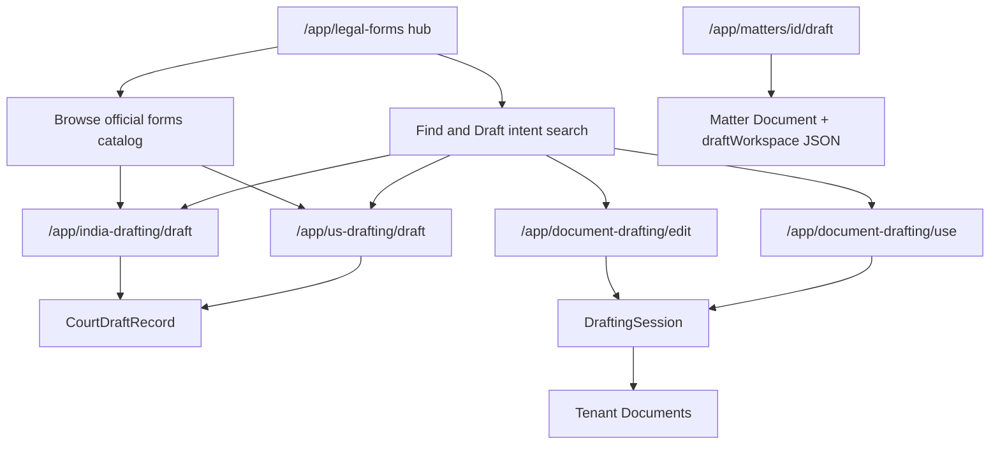
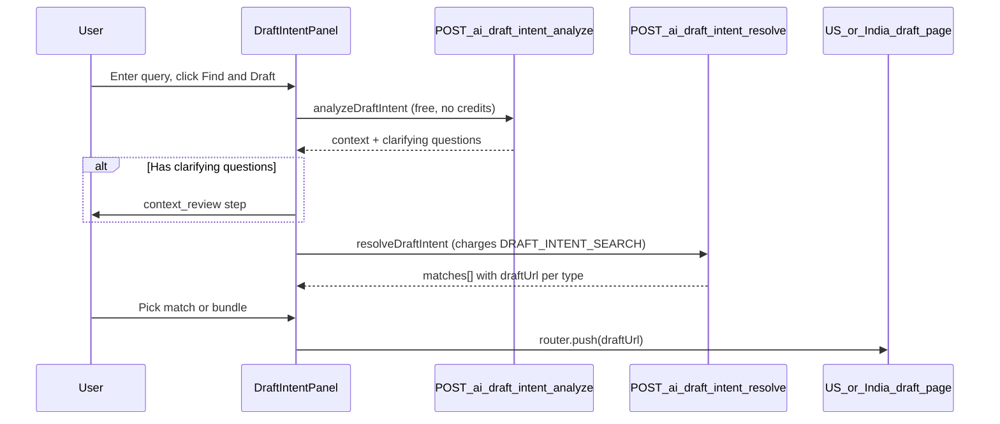
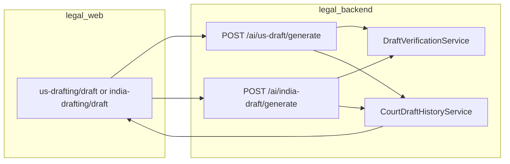
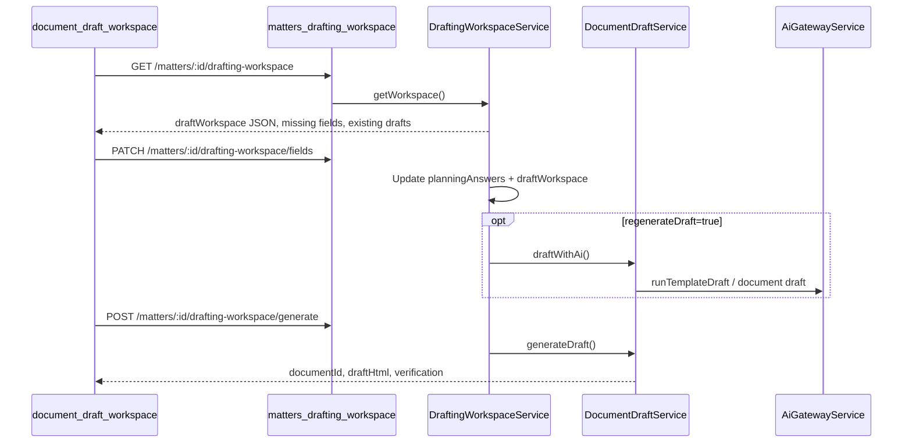

# Document Drafting Architecture

This document describes how **Document Drafting** works in the Umbrella web app (`legal_web`) and the backend APIs it calls (`legal_backend`). It covers UI entry points, user flows, API contracts, persistence, credits, and verification.

**Scope:** Web only. Mobile (`legal_app`) is out of scope.

---

## Table of contents

1. [Overview](#1-overview)
2. [Entry points and navigation](#2-entry-points-and-navigation)
3. [User flows](#3-user-flows)
4. [API reference](#4-api-reference)
5. [Data models](#5-data-models)
6. [Cross-cutting concerns](#6-cross-cutting-concerns)
7. [File index](#7-file-index)

---

## 1. Overview

Document Drafting is a multi-path system for starting, generating, editing, and saving legal documents. Users can:

- Describe what they want in natural language (**Find & Draft**)
- Browse a catalog of 10,800+ official forms (US, India, UK, Kenya)
- Generate AI drafts for court filings, contracts, and government forms
- Use firm or system **templates** via a questionnaire wizard
- **Upload & edit** existing documents
- Draft within a **matter** context (template selection + AI generation tied to case facts)
- Resume work from **saved drafts**

All paths converge on one of three outcomes:

1. A **CourtDraftRecord** — standalone AI draft (US/India editors, history sidebar)
2. A **DraftingSession** — in-progress template or import session
3. A **Matter document** — AI-generated HTML stored as a matter `Document` via `DocumentDraftService`



---

## 2. Entry points and navigation

### Sidebar hub

The sidebar **Document Drafting** item links to `/app/legal-forms` and stays active for related routes (India drafting, US drafting).

| File | Role |
|------|------|
| [legal_web/components/app-sidebar.tsx](legal_web/components/app-sidebar.tsx) | `DocumentDraftingNav` → `/app/legal-forms` |
| [legal_web/app/app/legal-forms/page.tsx](legal_web/app/app/legal-forms/page.tsx) | Page shell: workspace + draft history sidebar |
| [legal_web/components/legal-forms/legal-forms-workspace.tsx](legal_web/components/legal-forms/legal-forms-workspace.tsx) | Main hub UI: intent panel + catalog browse |

### User-facing surfaces

| Surface | Route | Primary component |
|---------|-------|-------------------|
| Official Legal Forms hub | `/app/legal-forms` | [legal-forms-workspace.tsx](legal_web/components/legal-forms/legal-forms-workspace.tsx) |
| US draft editor | `/app/us-drafting/draft` | [us-drafting/draft/page.tsx](legal_web/app/app/us-drafting/draft/page.tsx) |
| India draft editor | `/app/india-drafting/draft` | [india-drafting/draft/page.tsx](legal_web/app/app/india-drafting/draft/page.tsx) |
| Template wizard | `/app/document-drafting/use` | [use-template-wizard.tsx](legal_web/components/document-drafting/use-template-wizard.tsx) |
| Upload & edit | `/app/document-drafting/edit` | [document-drafting/edit/page.tsx](legal_web/app/app/document-drafting/edit/page.tsx) |
| Saved drafts | `/app/saved-drafts` | [saved-draft-list.tsx](legal_web/components/drafting/saved-draft-list.tsx) |
| Matter drafting | `/app/matters/[matterId]/draft` | [document-draft-workspace.tsx](legal_web/components/matters/document-draft-workspace.tsx) |

### Navigation helpers

[legal_web/lib/drafting/draft-navigation.ts](legal_web/lib/drafting/draft-navigation.ts) centralizes routing conventions:

| Export | Purpose |
|--------|---------|
| `DOCUMENT_DRAFTING_HREF` | Canonical hub URL (`/app/legal-forms`) |
| `appendReturnTo(url)` | Adds `?returnTo=/app/legal-forms` so editors can navigate back |
| `resolveDraftBackHref()` | Reads `returnTo` from URL search params |
| `buildSavedDraftHref(record)` | Maps a saved draft to US or India editor with `draftId` |
| `initDraftSet()` / `getDraftSet()` | Session storage for multi-document **filing bundles** |
| `readLegalFormsCountryFilter()` | Persists catalog country filter in `localStorage` |

When a user picks a match that is part of a bundle (e.g. petition + affidavit), the client calls `initDraftSet()` and walks items sequentially via `buildDraftSetNavUrl()`.

---

## 3. User flows

### Flow A — Find & Draft (intent search)

This is the primary flow on the Official Legal Forms page: user types a natural-language query (e.g. "employment contract in Karnataka") and clicks **Find & Draft**.



#### Frontend

| File | Role |
|------|------|
| [draft-intent-panel.tsx](legal_web/components/legal-forms/draft-intent-panel.tsx) | Three-step panel: `input` → `context_review` → `results` |
| [ActionContextRefineBlock.tsx](legal_web/components/legal-forms/ActionContextRefineBlock.tsx) | Optional supplemental context notes |
| [draft-intent.ts](legal_web/lib/api/draft-intent.ts) | `analyzeDraftIntent()`, `resolveDraftIntent()` |

**Step behavior:**

1. **input** — User enters query. On submit, calls `analyzeDraftIntent` (free).
2. **context_review** — If clarifying questions are returned, user answers them (jurisdiction, proceeding type, etc.). May also show Matter Intelligence panel.
3. **results** — Calls `resolveDraftIntent` (2 credits). Renders ranked matches. User clicks a match → `router.push(match.draftUrl)`.

If analyze fails, the panel falls through to resolve directly. If analyze returns zero questions, resolve runs immediately.

#### Backend

| File | Role |
|------|------|
| [draft-intent.controller.ts](legal_backend/src/ai/draft-intent/draft-intent.controller.ts) | `POST /ai/draft-intent/analyze`, `POST /ai/draft-intent/resolve` |
| [draft-intent-analyze.service.ts](legal_backend/src/ai/draft-intent/draft-intent-analyze.service.ts) | Free pre-analysis: context extraction, clarifying questions |
| [draft-intent.service.ts](legal_backend/src/ai/draft-intent/draft-intent.service.ts) | Paid resolve: search + rank + build URLs |
| [draft-intent.helpers.ts](legal_backend/src/ai/draft-intent/draft-intent.helpers.ts) | URL builders, text scoring, kind resolution |
| [draft-intent-bundles.ts](legal_backend/src/ai/draft-intent/draft-intent-bundles.ts) | Multi-document bundle suggestions |

**Resolve pipeline (simplified):**

1. Run **Matter Intelligence** pipeline (`consumer: 'draftIntent'`) to classify practice area, extract facts, and detect if clarification is required.
2. If MI says `shouldProceed` is false and required questions are unanswered → return questions only (0 credits for resolve in that early-exit path before debit — debit happens after clarification gate passes).
3. Debit **DRAFT_INTENT_SEARCH** (2 credits).
4. Classify query intent (`filing`, `contract`, `letter`, `unknown`) and resolve `documentKind`.
5. **Parallel search:**
   - Official forms via [legal-forms-search.service.ts](legal_backend/src/legal-forms/legal-forms-search.service.ts)
   - Curated draft kinds (India/US prompt catalog)
   - Firm/system templates from `DocumentTemplate`
6. Filter, rank, and inject fallback matches (`generate`, `import_edit`).
7. Build `draftUrl` for each match and return `documentBundle` if applicable.

#### Match types

Defined in [draft-intent.ts](legal_web/lib/api/draft-intent.ts):

| Type | Meaning | Typical destination |
|------|---------|---------------------|
| `official_form` | Catalog form match | US or India draft editor with `formNumber` / catalog kind |
| `curated_draft` | Known AI draft kind (e.g. bail application, NDA) | `/app/india-drafting/draft?kind=...` or US equivalent |
| `template` | Firm or system document template | `/app/document-drafting/use?templateId=...` |
| `generate` | Generic AI generation fallback | Draft editor with inferred `documentKind` |
| `import_edit` | User wants to edit an existing doc | `/app/document-drafting/edit` or import session |

The panel maps each type to an action label and href via `matchHref()` and `matchActionLabel()` in [draft-intent-panel.tsx](legal_web/components/legal-forms/draft-intent-panel.tsx).

---

### Flow B — Browse catalog (10,800+ official forms)

Users expand **Browse 10,800+ official forms** on the hub to search and filter the catalog directly (without intent resolve credits).

#### Frontend

| File | Role |
|------|------|
| [legal-forms-workspace.tsx](legal_web/components/legal-forms/legal-forms-workspace.tsx) | Paginated table, country/state/practice-area filters |
| [legal-forms.ts](legal_web/lib/api/legal-forms.ts) | `fetchLegalFormsPaginated()` → `GET /legal-forms` |
| [draft-links.ts](legal_web/lib/legal-forms/draft-links.ts) | `legalFormDraftLink(form)` → editor URL with `kind`, `formNumber`, etc. |

#### Backend

| File | Role |
|------|------|
| [legal-forms.controller.ts](legal_backend/src/legal-forms/legal-forms.controller.ts) | `GET /legal-forms`, `GET /legal-forms/intent-search`, `GET /legal-forms/:id` |
| [legal-forms.service.ts](legal_backend/src/legal-forms/legal-forms.service.ts) | Paginated queries, grouping by practice area |
| [legal-forms-search.service.ts](legal_backend/src/legal-forms/legal-forms-search.service.ts) | Hybrid intent search (used inside resolve, also exposed as `intent-search`) |

**Search scoring:** Hybrid vector (65%) + lexical (35%) over embedded form text. Minimum combined score threshold: 0.35. See `HYBRID_VECTOR_WEIGHT`, `HYBRID_LEXICAL_WEIGHT` in the search service.

**Form → editor routing** ([draft-links.ts](legal_web/lib/legal-forms/draft-links.ts)):

- **India (`IN`)** — Maps form numbers (e.g. `MCA-DIR-12`) to curated `kind` values, or falls back to `india_form_catalog` with form metadata in query params.
- **US / GB / KE** — Routes to `/app/us-drafting/draft` with `kind=us_form_catalog` and `formNumber`, `stateCode`, etc.

Catalog data lives in `JurisdictionForm` rows, seeded from scripts under `legal_backend/scripts/` (ingest/embed pipeline — data source only, not runtime logic).

---

### Flow C — AI generation in draft editor

After routing from intent search or catalog, the user lands on a draft editor with URL params: `kind`, `label`, `details`, `formNumber`, `draftId`, `autoGenerate`, etc.



#### Frontend

| File | Role |
|------|------|
| [us-drafting/draft/page.tsx](legal_web/app/app/us-drafting/draft/page.tsx) | US editor: case details form, generate, blank fill, export |
| [india-drafting/draft/page.tsx](legal_web/app/app/india-drafting/draft/page.tsx) | India editor: same pattern + India-specific accuracy UI |
| [us-drafting.ts](legal_web/lib/api/us-drafting.ts) | `generateUsDraft()`, `fillUsDraftBlanks()` |
| [india-drafting.ts](legal_web/lib/api/india-drafting.ts) | `generateIndiaDraft()`, `fillBlanks()`, `editIndiaDraft()` |
| [DraftAccuracyPanel.tsx](legal_web/components/drafting/accuracy/DraftAccuracyPanel.tsx) | Post-generation verification display |
| [DraftGenerationProgress.tsx](legal_web/components/drafting/accuracy/DraftGenerationProgress.tsx) | Multi-step generation progress |
| [draft-history-sidebar.tsx](legal_web/components/drafting/draft-history-sidebar.tsx) | Recent drafts on hub page |
| [draft-history.ts](legal_web/lib/api/draft-history.ts) | List/load/update saved drafts |

#### Backend — US

| File | Role |
|------|------|
| [us-draft.controller.ts](legal_backend/src/ai/us-draft/us-draft.controller.ts) | `POST /ai/us-draft/generate`, `POST /ai/us-draft/fill-blanks` |
| [us-draft.service.ts](legal_backend/src/ai/us-draft/us-draft.service.ts) | Prompt resolution + LLM + verification + history save |

**US prompt tiers** (resolved in `resolvePrompt()`):

1. **Tier 4** — Dynamic form number (USCIS, IRS, long-tail catalog via `formNumber`)
2. **Tier 4b** — Kind prefix `us_form_*`
3. **Tier 1** — Federal prompts (`US_FEDERAL_DRAFT_PROMPTS`)
4. **Tier 3** — State-named forms with bound state overlays
5. **Tier 2** — State-base prompts + `STATE_OVERLAYS` block

#### Backend — India

| File | Role |
|------|------|
| [india-draft.controller.ts](legal_backend/src/ai/india-draft/india-draft.controller.ts) | `generate`, `fill-blanks`, `edit`, `export`, file extract |
| [india-draft.service.ts](legal_backend/src/ai/india-draft/india-draft.service.ts) | Kind-based prompts, grounding, procedural routing, accuracy gates |

India generation runs a heavier pipeline: pre-checklist → procedural gate/router → research grounding → LLM → structure audit → verification → `CourtDraftRecord` persistence.

#### Saved drafts

After generation, both services persist via [court-draft-history.service.ts](legal_backend/src/ai/drafting/court-draft-history.service.ts):

| Endpoint | Purpose |
|----------|---------|
| `GET /ai/drafts/history` | List recent drafts for sidebar / saved-drafts page |
| `GET /ai/drafts/:id` | Load full draft text + metadata |
| `PATCH /ai/drafts/:id` | Save user edits |
| `PATCH /ai/drafts/:id/link-to-client` | Associate draft with client/matter |
| `DELETE /ai/drafts/:id` | Archive |

Reloading a saved draft: `buildSavedDraftHref()` adds `draftId` to the editor URL; the page fetches via `getDraftById()`.

---

### Flow D — Template / upload path

Used when intent resolve returns `template` or `import_edit`, or when the user clicks **Upload & edit** on the hub.

#### Template wizard

| Step | Route / action | Backend |
|------|----------------|---------|
| 1. Create session | `/app/document-drafting/use?templateId=...` | `POST /drafting-sessions` |
| 2. Answer questionnaire | Same page, wizard UI | `PATCH /drafting-sessions/:id/fields` |
| 3. Assemble template | Wizard step | `POST /drafting-sessions/:id/assemble` |
| 4. AI polish | Generate button | `POST /drafting-sessions/:id/generate` → `AiGatewayService.runTemplateDraft` |
| 5. Finalize | Save to documents | `POST /drafting-sessions/:id/finalize` |

Key files:

| Layer | File |
|-------|------|
| Page | [document-drafting/use/page.tsx](legal_web/app/app/document-drafting/use/page.tsx) |
| Wizard UI | [use-template-wizard.tsx](legal_web/components/document-drafting/use-template-wizard.tsx) |
| API client | [drafting-session.ts](legal_web/lib/api/drafting-session.ts) |
| Controller | [drafting-session.controller.ts](legal_backend/src/drafting-session/drafting-session.controller.ts) |
| Service | [drafting-session.service.ts](legal_backend/src/drafting-session/drafting-session.service.ts) |

Session `mode` values: `template`, `import`, `generate`. Status progresses through `DRAFT` → assembly → generation → finalized document link.

#### Upload & edit

| Step | Action | Backend |
|------|--------|---------|
| Import file | Upload on edit page | `POST /drafting-sessions/import` |
| Extract text | Auto or manual | `POST /drafting-sessions/:id/extract` |
| AI edit selection | Inline edit | `POST /drafting-sessions/:id/edit` |
| Export | PDF/DOCX | `POST /drafting-sessions/:id/export` |

Import uses [document-ingest.service.ts](legal_backend/src/drafting-session/document-ingest.service.ts) (PDF, DOCX, TXT, images).

---

### Flow E — Matter-attached drafting

Matters of type "document" (or flows that enable drafting) expose a dedicated draft workspace at `/app/matters/[matterId]/draft`.



#### Frontend

| File | Role |
|------|------|
| [document-draft-workspace.tsx](legal_web/components/matters/document-draft-workspace.tsx) | Full workspace: fields, clauses, preview, export |
| [generate-document-flow.tsx](legal_web/components/matters/generate-document-flow.tsx) | Onboarding flow into matter drafting |
| [drafting-workspace.ts](legal_web/lib/api/drafting-workspace.ts) | Workspace GET/PATCH/generate |
| [document-automation.ts](legal_web/lib/api/document-automation.ts) | Save/export matter documents |

#### Backend

| File | Role |
|------|------|
| [matters.controller.ts](legal_backend/src/matters/matters.controller.ts) | Drafting workspace routes under `/matters/:matterId/drafting-workspace/*` |
| [drafting-workspace.service.ts](legal_backend/src/matters/drafting-workspace.service.ts) | Workspace state, template selection, `generateDraft()` |
| [document-draft.service.ts](legal_backend/src/document-automation/document-draft.service.ts) | AI draft generation, HTML persistence, PDF/DOCX export |
| [document-automation.service.ts](legal_backend/src/document-automation/document-automation.service.ts) | Template assembly from questionnaire |

**Matter state:** `Matter.draftWorkspace` (JSON) stores `documentType`, `selectedClauses`, `missingFields`, `draftMarkdown`, etc. `Matter.planningAnswers` holds questionnaire responses used for template merge and AI context.

---

## 4. API reference

All tenant-scoped routes require the `TenantGuard` and pass `tenantId` via the API client header ([legal_web/lib/api/client.ts](legal_web/lib/api/client.ts)).

### Intent and catalog

| Method | Endpoint | Purpose | Frontend client |
|--------|----------|---------|-----------------|
| POST | `/ai/draft-intent/analyze` | Free pre-analysis, clarifying questions | [draft-intent.ts](legal_web/lib/api/draft-intent.ts) |
| POST | `/ai/draft-intent/resolve` | Match routing (2 credits) | [draft-intent.ts](legal_web/lib/api/draft-intent.ts) |
| GET | `/legal-forms` | Paginated catalog browse | [legal-forms.ts](legal_web/lib/api/legal-forms.ts) |
| GET | `/legal-forms/intent-search` | Direct intent search (optional) | [legal-forms.ts](legal_web/lib/api/legal-forms.ts) |
| GET | `/legal-forms/:id` | Single form detail | [legal-forms.ts](legal_web/lib/api/legal-forms.ts) |

### AI draft generation

| Method | Endpoint | Purpose | Frontend client |
|--------|----------|---------|-----------------|
| POST | `/ai/us-draft/generate` | US AI draft | [us-drafting.ts](legal_web/lib/api/us-drafting.ts) |
| POST | `/ai/us-draft/fill-blanks` | US placeholder auto-fill | [us-drafting.ts](legal_web/lib/api/us-drafting.ts) |
| POST | `/ai/india-draft/generate` | India AI draft | [india-drafting.ts](legal_web/lib/api/india-drafting.ts) |
| POST | `/ai/india-draft/fill-blanks` | India placeholder auto-fill | [india-drafting.ts](legal_web/lib/api/india-drafting.ts) |
| POST | `/ai/india-draft/edit` | India selection edit | [india-drafting.ts](legal_web/lib/api/india-drafting.ts) |
| POST | `/ai/india-draft/export` | India draft export | [india-drafting.ts](legal_web/lib/api/india-drafting.ts) |

### Saved drafts (court drafts)

| Method | Endpoint | Purpose | Frontend client |
|--------|----------|---------|-----------------|
| GET | `/ai/drafts/history` | List saved drafts | [draft-history.ts](legal_web/lib/api/draft-history.ts) |
| GET | `/ai/drafts/:id` | Load full draft | [draft-history.ts](legal_web/lib/api/draft-history.ts) |
| PATCH | `/ai/drafts/:id` | Save edits | [draft-history.ts](legal_web/lib/api/draft-history.ts) |
| PATCH | `/ai/drafts/:id/link-to-client` | Link to client/matter | [draft-history.ts](legal_web/lib/api/draft-history.ts) |
| DELETE | `/ai/drafts/:id` | Archive draft | [draft-history.ts](legal_web/lib/api/draft-history.ts) |

### Drafting sessions (templates / import)

| Method | Endpoint | Purpose | Frontend client |
|--------|----------|---------|-----------------|
| POST | `/drafting-sessions` | Create session | [drafting-session.ts](legal_web/lib/api/drafting-session.ts) |
| GET | `/drafting-sessions/:id` | Get session state | [drafting-session.ts](legal_web/lib/api/drafting-session.ts) |
| PATCH | `/drafting-sessions/:id/fields` | Update questionnaire answers | [drafting-session.ts](legal_web/lib/api/drafting-session.ts) |
| POST | `/drafting-sessions/:id/assemble` | Merge template + answers | [drafting-session.ts](legal_web/lib/api/drafting-session.ts) |
| POST | `/drafting-sessions/:id/generate` | AI-generate from assembled HTML | [drafting-session.ts](legal_web/lib/api/drafting-session.ts) |
| POST | `/drafting-sessions/:id/finalize` | Persist to Documents | [drafting-session.ts](legal_web/lib/api/drafting-session.ts) |
| POST | `/drafting-sessions/import` | Upload file to import | [drafting-session.ts](legal_web/lib/api/drafting-session.ts) |
| POST | `/drafting-sessions/:id/extract` | Extract text from import | [drafting-session.ts](legal_web/lib/api/drafting-session.ts) |
| POST | `/drafting-sessions/:id/edit` | AI edit selection | [drafting-session.ts](legal_web/lib/api/drafting-session.ts) |
| POST | `/drafting-sessions/:id/export` | Export session document | [drafting-session.ts](legal_web/lib/api/drafting-session.ts) |

### Matter drafting

| Method | Endpoint | Purpose | Frontend client |
|--------|----------|---------|-----------------|
| GET | `/matters/:matterId/drafting-workspace` | Load workspace | [drafting-workspace.ts](legal_web/lib/api/drafting-workspace.ts) |
| PATCH | `/matters/:matterId/drafting-workspace/fields` | Update fields / optional regenerate | [drafting-workspace.ts](legal_web/lib/api/drafting-workspace.ts) |
| POST | `/matters/:matterId/drafting-workspace/generate` | Generate AI draft | [drafting-workspace.ts](legal_web/lib/api/drafting-workspace.ts) |
| Various | `/document-automation/*` | Save, export matter documents | [document-automation.ts](legal_web/lib/api/document-automation.ts) |

---

## 5. Data models

Defined in [legal_backend/prisma/schema.prisma](legal_backend/prisma/schema.prisma).

### CourtDraftRecord

Standalone AI drafts from US/India editors.

| Field | Purpose |
|-------|---------|
| `kind` | Draft kind slug (e.g. `india_writ_petition_hc`, `us_form_catalog`) |
| `draftText` | Full draft body |
| `caseDetails`, `clientName`, `courtName`, `opposingParty` | Generation context |
| `verificationAudit` | JSON audit from verification pipeline |
| `creditsUsed` | Credits charged for generation |
| `clientId`, `matterId` | Optional links after `link-to-client` |

### DraftingSession

In-progress template wizard or import-edit sessions.

| Field | Purpose |
|-------|---------|
| `mode` | `template`, `import`, or `generate` |
| `forkedTemplateId` | Tenant copy of system template |
| `fieldValues`, `clauseAnswers` | Questionnaire state |
| `workingHtml` | Current assembled/edited HTML |
| `sourceDocumentId`, `sourceFileName` | Import source metadata |
| `documentId` | Set after finalize |

### Matter.draftWorkspace (JSON)

Ephemeral workspace state on a matter for integrated drafting:

```typescript
// Shape used by legal_web/lib/api/drafting-workspace.ts
{
  documentType?: string
  documentTitle?: string
  selectedClauses?: string[]
  missingFields?: DraftingMissingField[]
  draftMarkdown?: string
  // ...
}
```

Also related: `Matter.planningAnswers` (JSON) for questionnaire responses.

### JurisdictionForm

Official forms catalog (10,800+ rows).

| Field | Purpose |
|-------|---------|
| `countryCode` | `US`, `IN`, `GB`, `KE` |
| `jurisdiction` | State/region (e.g. `CA`, `Maharashtra`) |
| `practiceArea` | Taxonomy slug |
| `formName`, `formNumber`, `authority` | Display and search |
| `sourceUrl` | Official source link |

Populated by seed/ingest scripts in `legal_backend/scripts/` (e.g. `ingest-legal-forms-full-catalog.js`, `embed-legal-forms-catalog.ts`).

---

## 6. Cross-cutting concerns

### Credits

Backend costs: [legal_backend/src/ai-credits/credit-costs.ts](legal_backend/src/ai-credits/credit-costs.ts)

Frontend display mirror: [legal_web/lib/credits/draft-credit-costs.ts](legal_web/lib/credits/draft-credit-costs.ts)

| Task | Credits (typical) | When charged |
|------|-------------------|--------------|
| `DRAFT_INTENT_SEARCH` | 2 | `POST /ai/draft-intent/resolve` |
| Full AI draft (US/India) | 45 (floor) | `POST /ai/us-draft/generate`, `/ai/india-draft/generate` |
| Edit / fill-blanks | 1 | `fill-blanks`, `edit` endpoints |
| Field extract | 15 | Import extract flows |
| `DOCUMENT_DRAFT` | 45 (floor) | Matter/template AI generation via `DocumentDraftService` |

Frontend gating: `useInsufficientCreditsGate` + `CreditErrorBanner` in [draft-intent-panel.tsx](legal_web/components/legal-forms/draft-intent-panel.tsx) and draft editor pages. Wallet refresh via `invalidateCreditWalletQueries()` after successful API calls.

### Matter Intelligence

Runs during draft intent analyze/resolve ([draft-intent.service.ts](legal_backend/src/ai/draft-intent/draft-intent.service.ts)):

- Classifies practice area and document kind
- Extracts matter facts ([matter-fact-extractor.ts](legal_backend/src/ai/draft-intent/matter-fact-extractor.ts))
- Builds clarifying questions ([matter-clarification.service.ts](legal_backend/src/ai/draft-intent/matter-clarification.service.ts))
- Suggests multi-document bundles ([draft-intent-bundles.ts](legal_backend/src/ai/draft-intent/draft-intent-bundles.ts))
- Returns `matterProfile`, `matterGraph`, `taskGraph` for the MI panel in the UI

### Verification pipeline

Shared drafting safety layer under [legal_backend/src/ai/drafting/](legal_backend/src/ai/drafting/):

| Service | Role |
|---------|------|
| [draft-procedural-gate.service.ts](legal_backend/src/ai/drafting/draft-procedural-gate.service.ts) | Blocks procedurally invalid requests |
| [draft-procedural-router.service.ts](legal_backend/src/ai/drafting/draft-procedural-router.service.ts) | Routes to correct remedy (India) |
| [draft-research-grounding.service.ts](legal_backend/src/ai/drafting/draft-research-grounding.service.ts) | Grounds generation in retrieved sources |
| [draft-verification.service.ts](legal_backend/src/ai/drafting/draft-verification.service.ts) | Post-generation accuracy audit |
| [draft-citation-sanitizer.ts](legal_backend/src/ai/drafting/draft-citation-sanitizer.ts) | Removes hallucinated citations |
| [draft-structure-audit.service.ts](legal_backend/src/ai/drafting/draft-structure-audit.service.ts) | India pleading structure checks |

Frontend surfaces verification via [DraftAccuracyPanel](legal_web/components/drafting/accuracy/DraftAccuracyPanel.tsx), [DraftAuthorityInsights](legal_web/components/drafting/draft-authority-insights.tsx), [DraftAccuracyStepper](legal_web/components/drafting/accuracy/DraftAccuracyStepper.tsx), and [draft-verification.ts](legal_web/lib/api/draft-verification.ts).

### Case law and knowledge sources

Court-draft editors (`/app/india-drafting/draft`, `/app/us-drafting/draft`) now mirror Legal Research source controls:

| Surface | Component / API | Role |
|---------|-----------------|------|
| Source picker | [knowledge-source-picker.tsx](legal_web/components/research/knowledge-source-picker.tsx) | User selects statutes, case law, regulations, firm vault, web, etc. |
| Generate payload | `knowledgeSources?: string[]` on India/US draft DTOs | Passed to [draft-research-grounding.service.ts](legal_backend/src/ai/drafting/draft-research-grounding.service.ts) → `LegalRetrievalOrchestrator` |
| Similar cases | [DraftAuthorityInsights](legal_web/components/drafting/draft-authority-insights.tsx) | Citation audit + [SimilarCasesPanel](legal_web/components/research/similar-cases-panel.tsx) shown before draft body |
| Post-hoc enrich | `POST /draft-jobs/:jobId/enrich` (India v3), `POST /ai/us-draft/enrich` (US) | Modes: `case_laws`, `sections`, `both` via [case-law-enrich.service.ts](legal_backend/src/ai/unified-drafting/enrich/case-law-enrich.service.ts) |
| Pin authorities | [DraftPinnedAuthoritiesEditor.tsx](legal_web/components/india-drafting/DraftPinnedAuthoritiesEditor.tsx) | India-only manual case/section pins before generate |

**Per-path behavior:**

| Path | Pre-gen case-law retrieval | User source control | Similar cases UI |
|------|---------------------------|---------------------|------------------|
| India court draft (v1/v2/v3) | Yes — dispute pleadings require verified authorities; express notices/contracts/FIR skip by default ([draft-citation-policy.ts](legal_backend/src/ai/drafting/draft-citation-policy.ts)) | `knowledgeSources` + pin/enrich | [DraftAuthorityInsights](legal_web/components/drafting/draft-authority-insights.tsx) |
| US court draft (filing-grade) | Yes — motions, complaints, petitions, etc. | `knowledgeSources` + enrich | DraftAuthorityInsights |
| US form catalog (non-filing) | No grounding | N/A | N/A |
| Find & Draft hub | Routes to editors — preserves `?knowledgeSources=` in URL | [KnowledgeSourcePicker](legal_web/components/research/knowledge-source-picker.tsx) on context review | N/A (handoff to editor) |
| Template wizard | Yes — [runTemplateDraft](legal_backend/src/ai/ai-gateway.service.ts) via [shouldRetrieveCaseLawForDraft](legal_backend/src/ai/drafting/draft-citation-policy.ts) | Picker on preview step; `POST /drafting-sessions/:id/generate` | DraftAuthorityInsights + enrich toolbar |
| Matter workspace | Yes — same grounding pipeline via [draftWithAi](legal_backend/src/document-automation/document-draft.service.ts) | Picker in header; `POST /matters/:id/drafting-workspace/generate` | DraftAuthorityInsights + enrich toolbar |

Express-notice skip is bypassed when the user includes `case_law` in `knowledgeSources` or pins case laws manually.

### i18n

User-facing strings use the `drafting` namespace in [legal_web/messages/en.json](legal_web/messages/en.json) (and parallel locale files). Backend respects `Accept-Language` for generation locale via `resolveRequestLocale()`.

### Copilot integration

The hub and template wizard sync context to the AI copilot via `useCopilotContext()` — page `document-drafting-studio`, intent `DOCUMENT_DRAFT`, draft query, and document kind. See [copilot-context-syncer.tsx](legal_web/components/copilot/copilot-context-syncer.tsx) and [copilot-drafts.tsx](legal_web/components/copilot/copilot-drafts.tsx).

---

## 7. File index

Quick reference grouped by layer. Paths relative to repo root.

### Web — pages

- `legal_web/app/app/legal-forms/page.tsx` — Document Drafting hub
- `legal_web/app/app/us-drafting/draft/page.tsx` — US draft editor
- `legal_web/app/app/india-drafting/draft/page.tsx` — India draft editor
- `legal_web/app/app/india-drafting/page.tsx` — India format browser
- `legal_web/app/app/document-drafting/use/page.tsx` — Template wizard entry
- `legal_web/app/app/document-drafting/edit/page.tsx` — Upload & edit
- `legal_web/app/app/saved-drafts/page.tsx` — Saved drafts list
- `legal_web/app/app/matters/[matterId]/draft/page.tsx` — Matter draft workspace

### Web — components

- `legal_web/components/legal-forms/legal-forms-workspace.tsx`
- `legal_web/components/legal-forms/draft-intent-panel.tsx`
- `legal_web/components/legal-forms/ActionContextRefineBlock.tsx`
- `legal_web/components/document-drafting/use-template-wizard.tsx`
- `legal_web/components/us-drafting/us-drafting-workspace.tsx`
- `legal_web/components/india-drafting/india-drafting-workspace.tsx`
- `legal_web/components/india-drafting/SmartDraftRenderer.tsx`
- `legal_web/components/drafting/draft-history-sidebar.tsx`
- `legal_web/components/drafting/saved-draft-list.tsx`
- `legal_web/components/drafting/accuracy/*`
- `legal_web/components/matters/document-draft-workspace.tsx`
- `legal_web/components/matters/generate-document-flow.tsx`
- `legal_web/components/app-sidebar.tsx`

### Web — API clients and libs

- `legal_web/lib/api/draft-intent.ts`
- `legal_web/lib/api/legal-forms.ts`
- `legal_web/lib/api/us-drafting.ts`
- `legal_web/lib/api/india-drafting.ts`
- `legal_web/lib/api/draft-history.ts`
- `legal_web/lib/api/draft-verification.ts`
- `legal_web/lib/api/drafting-session.ts`
- `legal_web/lib/api/drafting-workspace.ts`
- `legal_web/lib/api/document-automation.ts`
- `legal_web/lib/drafting/draft-navigation.ts`
- `legal_web/lib/drafting/draft-field-schemas.ts`
- `legal_web/lib/drafting/draft-text-formatter.ts`
- `legal_web/lib/drafting/action-context-prompts.ts`
- `legal_web/lib/legal-forms/draft-links.ts`
- `legal_web/lib/credits/draft-credit-costs.ts`

### Backend — controllers

- `legal_backend/src/ai/draft-intent/draft-intent.controller.ts`
- `legal_backend/src/legal-forms/legal-forms.controller.ts`
- `legal_backend/src/ai/us-draft/us-draft.controller.ts`
- `legal_backend/src/ai/india-draft/india-draft.controller.ts`
- `legal_backend/src/ai/drafting/court-draft.controller.ts`
- `legal_backend/src/drafting-session/drafting-session.controller.ts`
- `legal_backend/src/matters/matters.controller.ts` (drafting-workspace routes)
- `legal_backend/src/document-automation/document-automation.controller.ts`

### Backend — services

- `legal_backend/src/ai/draft-intent/draft-intent.service.ts`
- `legal_backend/src/ai/draft-intent/draft-intent-analyze.service.ts`
- `legal_backend/src/ai/draft-intent/draft-intent.helpers.ts`
- `legal_backend/src/ai/draft-intent/draft-intent-bundles.ts`
- `legal_backend/src/legal-forms/legal-forms.service.ts`
- `legal_backend/src/legal-forms/legal-forms-search.service.ts`
- `legal_backend/src/ai/us-draft/us-draft.service.ts`
- `legal_backend/src/ai/india-draft/india-draft.service.ts`
- `legal_backend/src/ai/drafting/court-draft-history.service.ts`
- `legal_backend/src/ai/drafting/draft-verification.service.ts`
- `legal_backend/src/drafting-session/drafting-session.service.ts`
- `legal_backend/src/drafting-session/document-ingest.service.ts`
- `legal_backend/src/matters/drafting-workspace.service.ts`
- `legal_backend/src/document-automation/document-draft.service.ts`
- `legal_backend/src/document-automation/document-automation.service.ts`
- `legal_backend/src/ai/ai-gateway.service.ts` (template + generic document draft)

### Backend — config and data

- `legal_backend/prisma/schema.prisma` — `CourtDraftRecord`, `DraftingSession`, `JurisdictionForm`, `Matter.draftWorkspace`
- `legal_backend/src/config/templates/draft-field-schemas.ts`
- `legal_backend/src/config/templates/document-kinds.ts`
- `legal_backend/src/legal-forms/catalog.generated.ts`
- `legal_backend/src/ai-credits/credit-costs.ts`

### Backend — tests (representative)

- `legal_backend/test/unit/draft-intent.service.spec.ts`
- `legal_backend/test/unit/legal-forms-search.service.spec.ts`
- `legal_backend/test/unit/india-draft.service.spec.ts`
- `legal_backend/test/unit/court-draft-history.spec.ts`

---

## Related docs

- Matter Intelligence release notes: [docs/matter-intelligence/RELEASE-SIGNOFF.md](docs/matter-intelligence/RELEASE-SIGNOFF.md)
- Backend README (API overview): [legal_backend/README.md](legal_backend/README.md)
